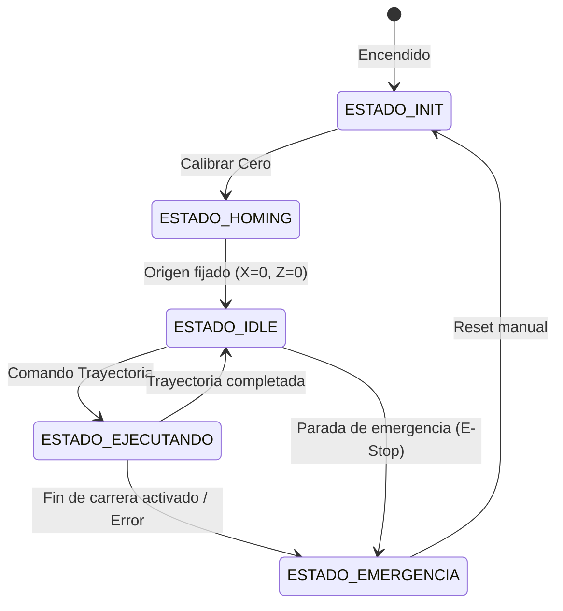

# Skill: Desarrollo de Firmware Embebido ARM para Control de Movimiento

Esta habilidad guía el diseño e implementación de código en C/C++ sobre microcontroladores ARM de 32 bits para el accionamiento de alta precisión de motores paso a paso, configuración de drivers Trinamic (TMC2209) y gestión de seguridad/sensores.

---

## 1. Arquitectura del Firmware y Temporización de Bajo Jitter

En sistemas de posicionamiento suave para evitar oscilaciones en cables suspendidos, **la irregularidad temporal (jitter) en los pulsos `STEP` es inaceptable**, ya que induce armónicos de vibración mecánica.

### 1.1. Patrón de Diseño: Generador por Temporizador Hardware (Timer ISR)
- **Regla crítica:** Nunca usar bucles de espera (`delay()`, `delayMicroseconds()`) para generar trenes de pulsos continuos.
- **Estructura recomendada:**
  1. **Temporizador de alta frecuencia (Base Timebase):** Interrupción periódica (ej. 20 kHz a 100 kHz) o recarga dinámica del temporizador (*Timer Reload / Match Interrupt*) según el intervalo $dt = 1 / f_{paso}$.
  2. **Separación de capas:**
     - **Capa Rápida (ISR del Timer):** Conmutación del pin `STEP`, avance del contador de pasos acumulados y cálculo del siguiente retardo $c_n$.
     - **Capa Lenta (Bucle Principal / Tarea RTOS):** Parseo de comandos serie, planificación de rampas de aceleración, comprobación térmica y actualización de telemetría.

### 1.2. Algoritmo de Cálculo de Rampas en Tiempo Real (Algoritmo de Austin / Eidson)
Para calcular el retardo entre pasos en perfil trapezoidal sin operaciones de coma flotante pesadas:
- Primer retardo de paso:
  $$c_0 = 0.676 \cdot f_{timer} \cdot \sqrt{\frac{2\theta_{paso}}{\alpha}}$$
- Siguiente retardo recursivo:
  $$c_n = c_{n-1} - \frac{2 c_{n-1}}{4n + 1}$$
  *donde $n$ es el número de paso actual en la rampa de aceleración.*

---

## 2. Configuración y Control de Drivers Trinamic TMC2209

Los drivers TMC2209 son idóneos para este TFG por su eliminación activa del ruido de conmutación electromagnética.

### 2.1. Conexión y Pines Clave
| Pin TMC2209 | Conexión MCU | Función |
| :--- | :--- | :--- |
| `EN` (Enable) | Salida GPIO | Nivel BAJO para habilitar los MOSFETs de potencia. |
| `DIR` (Direction) | Salida GPIO | Sentido de giro del husillo. |
| `STEP` (Step) | Salida Timer/PWM | Pulso de avance (mínimo $100\text{ ns}$ de ancho). |
| `PDN_UART` | Puerto UART (con resistencia $1\text{ k}\Omega$ en TX) | Configuración digital de registros internos por dirección ($0$ a $3$). |
| `DIAG` | Entrada con interrupción | Salida de detección de colisión (*StallGuard4*). |

### 2.2. Modos de Operación y Registros Cruciales
- **Modo StealthChop2 (`en_spreadCycle = 0`):**
  - **Obligatorio para este proyecto.** Modula la tensión con onda senoidal suave. Elimina por completo el "chillido" y las microvibraciones mecánicas de paso.
- **Configuración de Corriente por Registro (`GCONF`, `IHOLD_IRUN`):**
  $$I_{RMS} = \frac{CS + 1}{32} \cdot \frac{V_{FS}}{R_{SENSE} + 0.02\Omega} \cdot \frac{1}{\sqrt{2}}$$
  - Para resistencias de sensado $R_{SENSE} = 0.11\,\Omega$ habituales:
    - Ajustar corriente de trabajo a $600 - 800\text{ mA}$ RMS (evita calentamiento del motor en reposo).
    - Reducir corriente en reposo (*Standstill current*) al $30-50\%$ del valor nominal.

---

## 3. Máquina de Estados Finitos (FSM) de Control

El controlador debe implementar una FSM determinista para garantizar la seguridad del banco de ensayo:

### 3.1. Prácticas de Seguridad en Entradas de Final de Carrera (Endstops)
1. **Lógica Normalmente Cerrada (NC):** El interruptor conecta a masa durante el funcionamiento normal. Si un cable se corta o desconecta, el sistema lo interpreta inmediatamente como límite alcanzado (*Fail-safe*).
2. **Filtrado físico y por software:** Resistencia *pull-up* externa ($4.7\text{ k}\Omega$) y condensador cerámico de $100\text{ nF}$ en paralelo contra masa para absorber ruido inductivo de los motores.
3. **Debounce por software:** Mínimo de 3 lecturas consecutivas estables en la ISR antes de declarar tope alcanzado.

---

## 4. Protocolo de Comandos Serie y Telemetría

La interfaz PC-Microcontrolador se gestiona mediante un subconjunto simplificado de comandos tipo ASCII/G-code:

- `G28 [X] [Z]` : Realiza la secuencia de homing en los ejes indicados.
- `G1 X<pos_mm> Z<pos_mm> F<vel_mm_min> A<acc_mm_s2>` : Ejecuta movimiento coordinado suave.
- `M114` : Devuelve la posición actual en milímetros: `OK X:120.45 Z:50.00`.
- `M112` : Parada de emergencia instantánea (deshabilita drivers inmediatamente `EN = HIGH`).
- `M906 X<mA> Z<mA>` : Configuración dinámica de la corriente RMS de los drivers TMC.

---

## 5. Lista de Verificación (Checklist) de Calidad de Firmware

- [ ] Todas las variables compartidas entre la ISR del temporizador y el bucle principal están declaradas como `volatile`.
- [ ] No existen llamadas a `printf` ni asignaciones dinámicas de memoria (`malloc`/`new`) dentro de las interrupciones.
- [ ] Los pines de activación de los motores (`EN`) arrancan en estado deshabilitado (`HIGH`) hasta completar la inicialización de los registros.
- [ ] Se implementa un *timeout* en la comunicación serie para abortar maniobras si se pierde la conexión con el PC.
