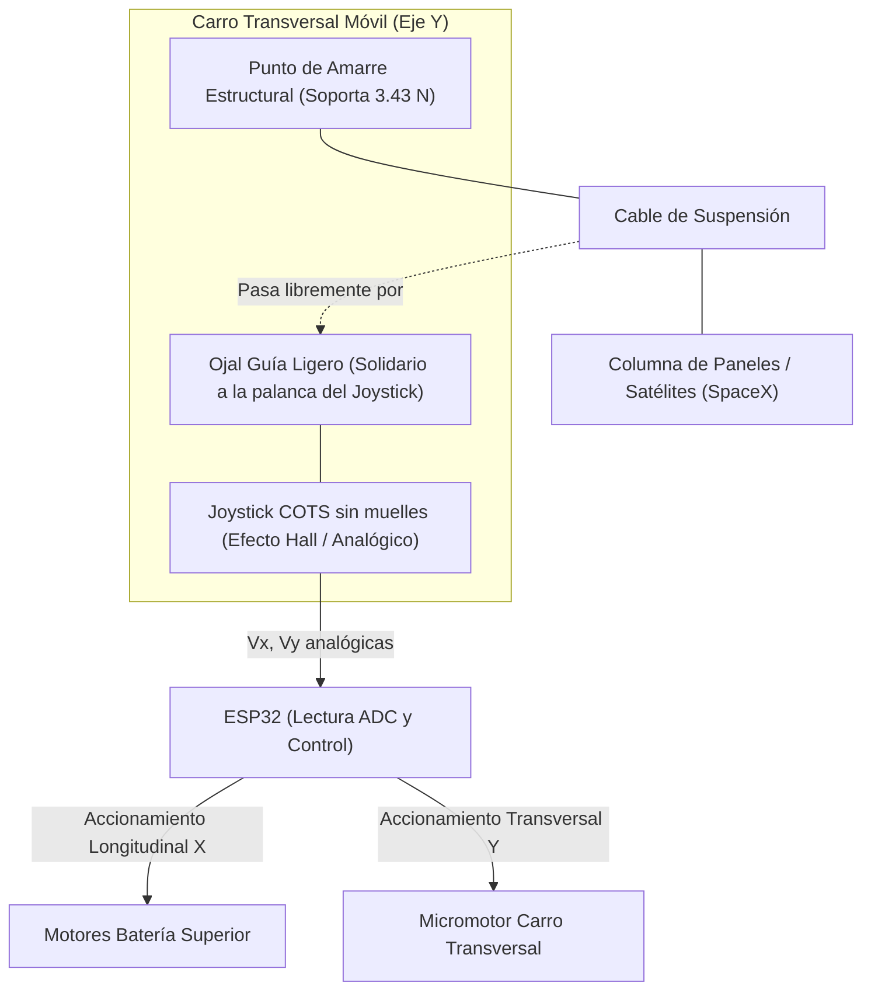

# 📑 Informe Técnico Profesional de Ingeniería - 27/10/2026

> **Proyecto:** Sistema Embebido de Control de Posición Bidireccional para Orientación de Prototipos Espaciales en Microgravedad Simulada  
> **Titulación:** Trabajo de Fin de Grado (TFG)  
> **Directorio de Trabajo Oficial:** [`DESARROLLO_TFG/`](file:///C:/Users/Usuario/Desktop/universidad/clase/TFG/DESARROLLO_TFG/)  
> **Fecha de Emisión:** 27 de octubre de 2026  
> **Documento:** `INFORME_2026_10_27_DESPLIEGUE_SPACEX_JOYSTICK_REESTRUCTURACION.md`

---

## 1. Resumen Ejecutivo y Objetivos de la Jornada

En la sesión del 27/10/2026 se han abordado hitos conceptuales, metodológicos y arquitectónicos esenciales para el desarrollo del TFG:

1. **Definición Conceptual de la Simulación de Despliegue Espacial tipo SpaceX:**
   - Modelado conceptual de la maniobra de eyección de una columna de paneles satelitales (análogo al despliegue en bloque de Starlink) suspendidos mediante cable.
   - Planteamiento de una bancada superior cartesiana con **batería de perfiles paralelos de avance longitudinal** y un **carro móvil transversal motorizado** de centrado lateral.
2. **Análisis Físico y Mecatrónico del Sensor de Inclinación de Hilo:**
   - Estudio de viabilidad técnica de un joystick comercial COTS para medición de deflexión angular ($\theta_x, \theta_y$) en tiempo real.
   - Identificación de las restricciones físicas críticas: interferencia por muelles de retorno al centro ($F_{muelle} \gg F_{hilo}$) y necesidad de desacoplo de la carga axial de tracción ($350\text{ g}$).
3. **Formalización en OpenSpec (`despliegue-satelites-joystick-esp32`):**
   - Creación y validación estricta de la propuesta formal con `proposal.md`, `specs/`, `design.md` y `tasks.md`.
   - Registro y congelación del cuestionario técnico de medidas y componentes, pausando el proceso hasta la orden explícita de reactivación por parte del usuario.
4. **Reestructuración Definitiva del Espacio de Trabajo:**
   - Supresión del esquema de carpetas diarias en la raíz de `TFG/`.
   - Establecimiento de [`DESARROLLO_TFG/`](file:///C:/Users/Usuario/Desktop/universidad/clase/TFG/DESARROLLO_TFG/) como espacio de trabajo único y permanente.
   - Creación del repositorio histórico [`backups/`](file:///C:/Users/Usuario/Desktop/universidad/clase/TFG/backups/) con todas las sesiones archivadas (`09_10_26` a `27_10_26`).
   - Implementación del script de backup automatizado [`backup.ps1`](file:///C:/Users/Usuario/Desktop/universidad/clase/TFG/DESARROLLO_TFG/backup.ps1).

---

## 2. Fundamentación Física y Mecatrónica

### 2.1. Dinámica de la Perturbación Pendular en el Hilo

El prototipo suspendido de masa nominal $m_s = 0{,}35\text{ kg}$ ($350\text{ g}$) y longitud de cable $L = 0{,}60\text{ m}$ experimenta una tensión nominal en régimen quasi-estático:
$$T \approx m_s \cdot g = 0{,}35\text{ kg} \cdot 9{,}81\text{ m/s}^2 \approx 3{,}4335\text{ N}$$

Cuando el satélite avanza o se perturba lateralmente provocando una desviación angular $\theta$ respecto a la vertical, se genera una fuerza horizontal pendular restauradora quefalsea el ensayo de microgravedad:
$$F_x = T \sin\theta \approx m_s g \theta \quad (\text{para }\theta \ll 1\text{ rad})$$

Para una inclinación umbral de $\theta = 0{,}5^\circ \approx 0{,}00873\text{ rad}$:
$$F_x \approx 3{,}4335\text{ N} \cdot 0{,}00873 \approx 0{,}02996\text{ N} \approx 3\text{ gramos-fuerza (gf)}$$

### 2.2. Restricciones para la Selección del Joystick COTS

Un joystick comercial de pulgar estándar (tipo KY-023 o gamepad de consola) incorpora un muelle helicoidal interno de centrado con una fuerza de retorno típica de entre $0{,}5\text{ N}$ y $2\text{ N}$ ($50\text{ a }200\text{ gf}$).
- **Incompatibilidad directa:** Como la fuerza inducida por el hilo ($0{,}03\text{ N}$) es entre $15$ y $60$ veces inferior a la del muelle, el hilo no vencería la resistencia mecánica del sensor y el muelle perturbaría al satélite.
- **Solución técnica adoptada:** El joystick a adquirir debe ser libre de muelles de centrado (*springless*), o bien un gimbal de radiocontrol de efecto Hall (tipo FrSky M9 / RadioMaster) cuyos muelles se desactivan externamente mediante tornillo regulador, con rodamientos de bolas de fricción prácticamente nula.
- **Desacoplo de carga axial:** El cable de tracción se ancla a la estructura portante del carro transversal; el sensor joystick solo acompaña la inclinación angular mediante un ojal guía de bajo rozamiento sin soportar el peso suspendido.



---

## 3. Estado de OpenSpec y Gestión del Contexto

### 3.1. Propuesta `despliegue-satelites-joystick-esp32`
- **Ubicación:** [`openspec/changes/despliegue-satelites-joystick-esp32/`](file:///C:/Users/Usuario/Desktop/universidad/clase/TFG/DESARROLLO_TFG/openspec/changes/despliegue-satelites-joystick-esp32/)
- **Estado de validación:** Aprobada y validada en modo estricto (`openspec validate --strict`).
- **Estado de ejecución:** **Pausada a petición del usuario**.
- **Cuestionario congelado en `design.md`:**
  - Longitud de los perfiles de avance en Fusion 360.
  - Sección del perfil (2020 vs 2040) y número de perfiles paralelos.
  - Modelo exacto del joystick COTS a adquirir.
  - Motorización longitudinal y transversal (NEMA 17/14, micromotorreductor N20, correas GT2 vs husillo).
  - Masa y número de paneles a desplegar.

> **Procedimiento de reactivación:** Bastará que el usuario indique *"seguir con el proceso de los perfiles de fusion"* para desbloquear las tareas y acometer el modelado CAD y el firmware en el ESP32.

---

## 4. Reestructuración de la Arquitectura de Directorios

Se ha ejecutado la migración estructural del proyecto conforme al acuerdo formal:

1. **Directorio Permanente:** [`DESARROLLO_TFG/`](file:///C:/Users/Usuario/Desktop/universidad/clase/TFG/DESARROLLO_TFG/) agrupa todo el código vivo, modelos CAD Fusion 360, especificaciones OpenSpec y repositorio Git local.
2. **Repositorio Histórico de Backups:** [`backups/`](file:///C:/Users/Usuario/Desktop/universidad/clase/TFG/backups/) almacena de forma inmutable todas las sesiones de trabajo previas:
   - `09_10_26`
   - `15_10_26`
   - `23_10_26`
   - `26_10_26`
   - `27_10_26`
3. **Script de Backup Automatizado:** [`backup.ps1`](file:///C:/Users/Usuario/Desktop/universidad/clase/TFG/DESARROLLO_TFG/backup.ps1), ejecutable bajo demanda o al cierre de jornada mediante:
   ```powershell
   .\backup.ps1
   ```
   El cual crea automáticamente una instantánea fechada `backups/backup_YYYY_MM_DD_HHmmss`.

---

## 5. Actualización Normativa en `AGENTS.md`

Se han introducido y versionado tres reglas inviolables en el manual operativo:
1. **Regla 1 (Ampliación - Consulta Obligatoria):** Obligación estricta de preguntar al usuario cualquier duda sobre valores numéricos, medidas, carreras, cargas o dimensiones antes de asumir datos.
2. **Regla 6 (Informe Continuo e Incremental en Tiempo Real):** Prohibición de esperar al cierre del día para documentar. El informe técnico se va redactando y versionando dinámicamente conforme se avanza en cada cálculo, código, modelo o decisión.
3. **Regla 9 (Protocolo de Backups):** Obligación de operar exclusivamente en `DESARROLLO_TFG/` y generar backups sistemáticos al cierre o bajo petición.

---

## 6. Próximos Pasos para la Siguiente Sesión

1. Abrir la sesión de trabajo directamente en la carpeta [`DESARROLLO_TFG/`](file:///C:/Users/Usuario/Desktop/universidad/clase/TFG/DESARROLLO_TFG/).
2. Cuando el usuario lo indique (*"seguir con los perfiles de fusion"*):
   - Resolver las medidas y componentes pendientes.
   - Extender el modelo CAD de Fusion 360 con la batería superior y el carro transversal.
   - Implementar el firmware de lectura y filtrado del joystick en el microcontrolador ESP32.
