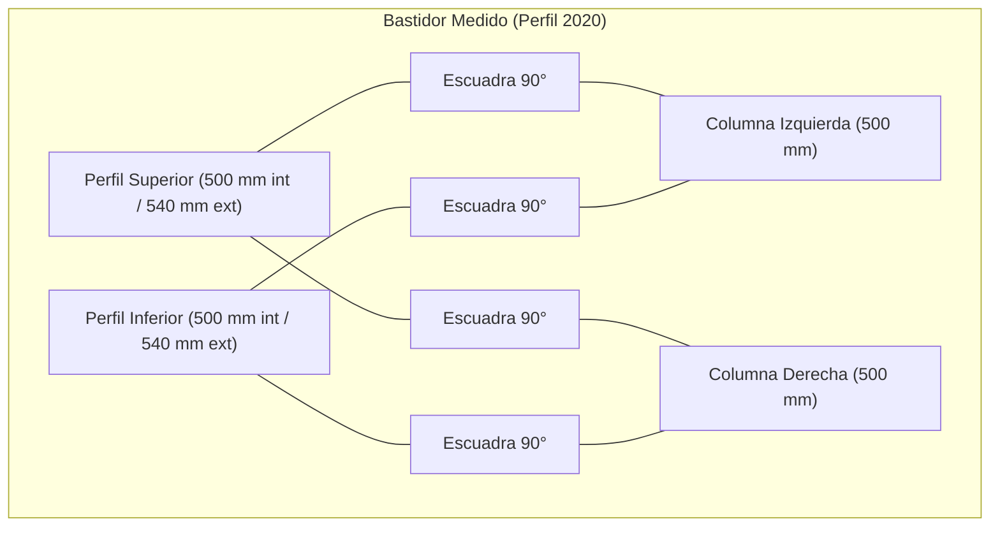
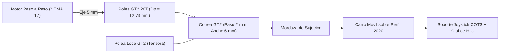

# 📑 Informe Técnico Profesional de Ingeniería - 28/10/2026 (En Progreso)

> **Proyecto:** Sistema Embebido de Control de Posición Bidireccional para Orientación de Prototipos Espaciales en Microgravedad Simulada  
> **Titulación:** Trabajo de Fin de Grado (TFG)  
> **Directorio de Trabajo Oficial:** [`DESARROLLO_TFG/`](file:///C:/Users/Usuario/Desktop/universidad/clase/TFG/DESARROLLO_TFG/)  
> **Fecha de Inicio de Sesión:** 28 de octubre de 2026  
> **Modalidad Documental:** Informe Vivo Continuo e Incremental (actualizado en tiempo real)  
> **Documento:** `INFORME_2026_10_28_LEVANTAMIENTO_MEDIDAS_Y_DISENO_CARRO_GT2.md`

---

## 1. Resumen Ejecutivo y Objetivos de la Sesión

En la sesión de trabajo del 28/10/2026 se han alcanzado los siguientes hitos de ingeniería:

1. **Recepción y Procesamiento del Levantamiento Métrico Real:**
   - Análisis visual y geométrico de las 8 imágenes reales y croquis manuscrito aportados por el usuario en el directorio [`fotos medidas/`](file:///C:/Users/Usuario/Desktop/universidad/clase/TFG/DESARROLLO_TFG/fotos%20medidas/).
   - Verificación de la sección de perfil de aluminio estructural: **V-Slot / T-Slot 2020** ($20\text{ mm} \times 20\text{ mm}$).
   - Determinación de las dimensiones nominales del portal base: altura de montantes $500\text{ mm}$, luz interior entre columnas $500\text{ mm}$, y ancho exterior total $540\text{ mm}$ con escuadras de fundición de aluminio de $90^\circ$.
2. **Definición de la Transmisión Cinemática del Carro Móvil Transversal:**
   - Especificación técnica solicitada por el usuario: accionamiento por **cinta síncrona tipo impresora 3D (Correa GT2)** mediante **motor paso a paso**, tanto para arrastrar la correa como para desplazar el carro que circulará a lo largo del perfil/varilla de la bancada superior.
3. **Actualización de Artefactos OpenSpec y Memoria Técnica:**
   - Actualización de [`design.md`](file:///C:/Users/Usuario/Desktop/universidad/clase/TFG/DESARROLLO_TFG/openspec/changes/despliegue-satelites-joystick-esp32/design.md) y [`tasks.md`](file:///C:/Users/Usuario/Desktop/universidad/clase/TFG/DESARROLLO_TFG/openspec/changes/despliegue-satelites-joystick-esp32/tasks.md) en la rama activa `change/despliegue-satelites-joystick-seguimiento`, superando la validación estricta con cero discrepancias.

---

## 2. Levantamiento Dimensional y Análisis Estructural

A partir de las imágenes de taller y el cuaderno de notas técnico (`28-10-26`), se tabulan los datos geométricos del bastidor:

| Elemento Estructural | Magnitud / Tipo | Valor Medido | Tolerancia / Observaciones |
| :--- | :--- | :--- | :--- |
| **Sección del Perfil** | Perfilería de aluminio ranurado | $20 \times 20\text{ mm}$ | Ranura estándar de $6\text{ mm}$ (serie 20) |
| **Montantes Verticales ($Z$)** | Longitud de corte de perfiles | $500\text{ mm}$ ($50\text{ cm}$) | 2 unidades idénticas |
| **Luz Horizontal Interior ($Y_{int}$)** | Distancia entre caras internas | $500\text{ mm}$ ($50\text{ cm}$) | Determina la carrera útil del carro |
| **Ancho Total Exterior ($Y_{ext}$)** | Extremo a extremo de la estructura | $540\text{ mm}$ ($54\text{ cm}$) | $20\text{ mm} + 500\text{ mm} + 20\text{ mm}$ |
| **Escuadras de Unión** | Escuadras triangulares de 90° | Fundición de aluminio | Fijación con tornillos y tuercas T M4/M5 |

---

## 3. Ingeniería de la Transmisión por Correa GT2 (Carro Transversal)

### 3.1. Selección de Componentes de la Transmisión
Siguiendo las directrices del usuario:
- **Correa Síncrona:** Tipo **GT2** de neopreno reforzado con fibra de vidrio ($2\text{ mm}$ de paso entre dientes, $6\text{ mm}$ de ancho de banda). Presenta perfil curvilíneo que elimina el juego angular y minimiza el estiramiento elástico.
- **Polea Motriz:** Polea GT2 de 20 dientes ($Z = 20$), diámetro primitivo:
  $$D_p = \frac{Z \cdot p}{\pi} = \frac{20 \cdot 2\text{ mm}}{\pi} \approx 12{,}73\text{ mm}$$
- **Avance Lineal por Revolución:**
  $$Avance = Z \cdot p = 20 \times 2\text{ mm} = 40\text{ mm/vuelta}$$
- **Actuador:** Motor paso a paso NEMA 17 (ángulo de paso $\alpha = 1{,}8^\circ \to 200\text{ pasos/rev}$).
- **Resolución Cinemática con Driver a 16 Micropasos:**
  $$\delta_y = \frac{40\text{ mm}}{200 \times 16} = \frac{40}{3200} = 0{,}0125\text{ mm/micropaso} \quad (12{,}5\,\mu\text{m})$$

### 3.2. Dinámica de Seguimiento del Péndulo
Para cancelar el balanceo pendular natural ($\omega_n = 4{,}0435\text{ rad/s}$, período $T_n \approx 1{,}5539\text{ s}$), el carro superior debe ser capaz de acelerar y alcanzar velocidades acordes a la velocidad tangencial máxima del satélite.

La velocidad lineal del carro transversal con el motor girando a $10\text{ rps}$ ($600\text{ rpm}$):
$$v_{max} = 10\text{ rev/s} \times 40\text{ mm/rev} = 400\text{ mm/s}$$

Esta velocidad supera ampliamente la velocidad máxima del péndulo para oscilaciones admisibles ($\le 0{,}5^\circ$), garantizando que el carro no sufra retraso de fase en el seguimiento servoguiado.

---

## 4. Estado de los Módulos y Próximos Pasos Inmediatos

1. **Modelado CAD en Fusion 360:**
   - Incorporar en el ensamblaje superior la batería de perfiles longitudinales apoyados sobre el pórtico de $540\text{ mm}$.
   - Modelar el soporte para el motor NEMA 17 en un extremo del perfil transversal.
   - Modelar el soporte de la polea tensora GT2 en el extremo opuesto.
   - Diseñar el carro deslizante con ruedas V-wheel y el anclaje de correa.
2. **Firmware ESP32:**
   - Configurar generación de pulsos `STEP`/`DIR` en el ESP32 para el driver de motor paso a paso del carro transversal sincronizado con la lectura analógica del joystick.
