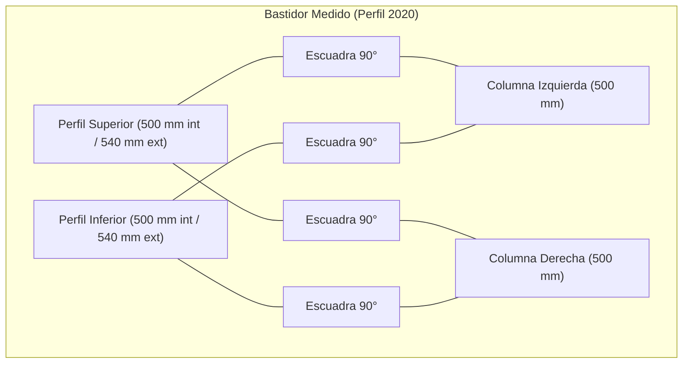
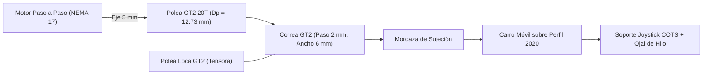
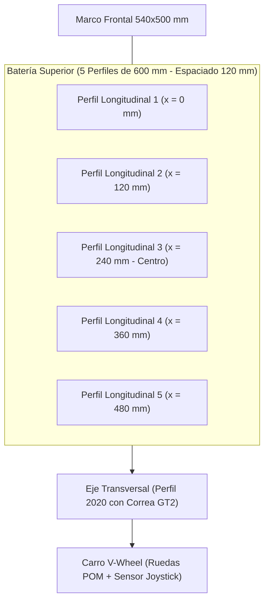

# 📑 Informe Técnico Profesional de Ingeniería - 28/10/2026 (En Progreso)

> **Proyecto:** Sistema Embebido de Control de Posición Bidireccional para Orientación de Prototipos Espaciales en Microgravedad Simulada  
> **Titulación:** Trabajo de Fin de Grado (TFG)  
> **Directorio de Trabajo Oficial:** [`DESARROLLO_TFG/`](file:///C:/Users/Usuario/Desktop/universidad/clase/TFG/DESARROLLO_TFG/)  
> **Fecha de Inicio de Sesión:** 28 de octubre de 2026  
> **Modalidad Documental:** Informe Vivo Continuo e Incremental (actualizado en tiempo real)  
> **Documento:** `INFORME_2026_10_28_LEVANTAMIENTO_MEDIDAS_Y_DISENO_CARRO_GT2.md`

---

## 1. Resumen Ejecutivo y Objetivos de la Sesión

En la sesión de trabajo del 28/10/2026 se han alcanzado los siguientes hitos de ingeniería:

1. **Recepción y Procesamiento del Levantamiento Métrico Real:**
   - Análisis visual y geométrico de las 8 imágenes reales y croquis manuscrito aportados por el usuario en el directorio [`fotos medidas/`](file:///C:/Users/Usuario/Desktop/universidad/clase/TFG/DESARROLLO_TFG/fotos%20medidas/).
   - Verificación de la sección de perfil de aluminio estructural: **V-Slot / T-Slot 2020** ($20\text{ mm} \times 20\text{ mm}$).
   - Determinación de las dimensiones nominales del portal base: altura de montantes $500\text{ mm}$, luz interior entre columnas $500\text{ mm}$, y ancho exterior total $540\text{ mm}$ con escuadras de fundición de aluminio de $90^\circ$.
2. **Definición de la Transmisión Cinemática del Carro Móvil Transversal:**
   - Especificación técnica solicitada por el usuario: accionamiento por **cinta síncrona tipo impresora 3D (Correa GT2)** mediante **motor paso a paso**, tanto para arrastrar la correa como para desplazar el carro que circulará a lo largo del perfil/varilla de la bancada superior.
3. **Actualización de Artefactos OpenSpec y Memoria Técnica:**
   - Actualización de [`design.md`](file:///C:/Users/Usuario/Desktop/universidad/clase/TFG/DESARROLLO_TFG/openspec/changes/despliegue-satelites-joystick-esp32/design.md) y [`tasks.md`](file:///C:/Users/Usuario/Desktop/universidad/clase/TFG/DESARROLLO_TFG/openspec/changes/despliegue-satelites-joystick-esp32/tasks.md) en la rama activa `change/despliegue-satelites-joystick-seguimiento`, superando la validación estricta con cero discrepancias.

---

## 2. Levantamiento Dimensional y Análisis Estructural

A partir de las imágenes de taller y el cuaderno de notas técnico (`28-10-26`), se tabulan los datos geométricos del bastidor:

| Elemento Estructural | Magnitud / Tipo | Valor Medido | Tolerancia / Observaciones |
| :--- | :--- | :--- | :--- |
| **Sección del Perfil** | Perfilería de aluminio ranurado | $20 \times 20\text{ mm}$ | Ranura estándar de $6\text{ mm}$ (serie 20) |
| **Montantes Verticales ($Z$)** | Longitud de corte de perfiles | $500\text{ mm}$ ($50\text{ cm}$) | 2 unidades idénticas |
| **Luz Horizontal Interior ($Y_{int}$)** | Distancia entre caras internas | $500\text{ mm}$ ($50\text{ cm}$) | Determina la carrera útil del carro |
| **Ancho Total Exterior ($Y_{ext}$)** | Extremo a extremo de la estructura | $540\text{ mm}$ ($54\text{ cm}$) | $20\text{ mm} + 500\text{ mm} + 20\text{ mm}$ |
| **Escuadras de Unión** | Escuadras triangulares de 90° | Fundición de aluminio | Fijación con tornillos y tuercas T M4/M5 |

---

## 3. Ingeniería de la Transmisión por Correa GT2 (Carro Transversal)

### 3.1. Selección de Componentes de la Transmisión
Siguiendo las directrices del usuario:
- **Correa Síncrona:** Tipo **GT2** de neopreno reforzado con fibra de vidrio ($2\text{ mm}$ de paso entre dientes, $6\text{ mm}$ de ancho de banda). Presenta perfil curvilíneo que elimina el juego angular y minimiza el estiramiento elástico.
- **Polea Motriz:** Polea GT2 de 20 dientes ($Z = 20$), diámetro primitivo:
  $$D_p = \frac{Z \cdot p}{\pi} = \frac{20 \cdot 2\text{ mm}}{\pi} \approx 12{,}73\text{ mm}$$
- **Avance Lineal por Revolución:**
  $$Avance = Z \cdot p = 20 \times 2\text{ mm} = 40\text{ mm/vuelta}$$
- **Actuador:** Motor paso a paso NEMA 17 (ángulo de paso $\alpha = 1{,}8^\circ \to 200\text{ pasos/rev}$).
- **Resolución Cinemática con Driver a 16 Micropasos:**
  $$\delta_y = \frac{40\text{ mm}}{200 \times 16} = \frac{40}{3200} = 0{,}0125\text{ mm/micropaso} \quad (12{,}5\,\mu\text{m})$$

### 3.2. Dinámica de Seguimiento del Péndulo
Para cancelar el balanceo pendular natural ($\omega_n = 4{,}0435\text{ rad/s}$, período $T_n \approx 1{,}5539\text{ s}$), el carro superior debe ser capaz de acelerar y alcanzar velocidades acordes a la velocidad tangencial máxima del satélite.

La velocidad lineal del carro transversal con el motor girando a $10\text{ rps}$ ($600\text{ rpm}$):
$$v_{max} = 10\text{ rev/s} \times 40\text{ mm/rev} = 400\text{ mm/s}$$

Esta velocidad supera ampliamente la velocidad máxima del péndulo para oscilaciones admisibles ($\le 0{,}5^\circ$), garantizando que el carro no sufra retraso de fase en el seguimiento servoguiado.

---

## 4. Decisiones de Diseño Aprobadas (Sesión 28/10/2026)

Tras la consulta formal, el usuario ha validado las siguientes especificaciones mecánicas:

1. **Guiado del Carrito Móvil (Opción A - Ruedas V-Wheel):**
   - El carro transversal se desplazará directamente sobre las ranuras en V del perfil de aluminio 2020 mediante ruedas **V-Wheel de POM** con rodamientos 625ZZ.
   - Incorporará tuercas espaciadoras excéntricas para eliminar cualquier holgura o juego mecánico en las pistas.
2. **Ubicación del Motor Paso a Paso Transversal:**
   - Montaje del motor paso a paso (NEMA 17) **fijo en el extremo lateral del perfil** mediante soporte estructural impreso en 3D / pletina de aluminio.
   - En el extremo opuesto se sitúa el tensor con polea loca idler GT2.
   - El carro móvil resulta ultraligero al no cargar el peso del motor, permitiendo mayores aceleraciones y una respuesta dinámica óptima para el lazo servoguiado.
3. **Batería Superior de Avance Longitudinal:**
   - Estructura superior formada por una **batería de 5 perfiles de aluminio paralelos**.
   - Longitud nominal seleccionada: **$600\text{ mm}$** (superior a los $500\text{ mm}$ del marco base para proporcionar mayor carrera útil de eyección).
   - **Distribución geométrica transversal:**  
     Para una luz interior de $500\text{ mm}$, distribuyendo los 5 perfiles de $20\text{ mm}$:
     $$\text{Espaciado entre centros} = \frac{500\text{ mm} - 20\text{ mm}}{5 - 1} = \frac{480\text{ mm}}{4} = 120\text{ mm}$$
     Se obtienen 4 vanos de $100\text{ mm}$ libres entre caras de perfiles y $120\text{ mm}$ entre ejes, garantizando un emparrillado simétrico de gran rigidez torsional.

---

## 5. Implementación de Artefactos CAD 3D y Automatización en Fusion 360

Se han desarrollado y versionado los siguientes modelos y scripts en el repositorio:

1. **Soporte NEMA 17 para Extremo de Perfil 2020 ([`cad/soporte_motor_nema17_2020.scad`](file:///C:/Users/Usuario/Desktop/universidad/clase/TFG/DESARROLLO_TFG/cad/soporte_motor_nema17_2020.scad)):**
   - Placa vertical para motor NEMA 17 con taladros M3 a $31\text{ mm}$ y cuello de centrado de $23\text{ mm}$.
   - Alas perpendiculares de anclaje a la ranura del perfil 2020 con taladro pasante M5 y chaflán para tuerca T.
   - Cartelas triangulares de refuerzo lateral diseñadas para soportar la tensión de la correa sin flexión.
2. **Soporte Tensor Idler GT2 ([`cad/soporte_tensor_idler_2020.scad`](file:///C:/Users/Usuario/Desktop/universidad/clase/TFG/DESARROLLO_TFG/cad/soporte_tensor_idler_2020.scad)):**
   - Horquilla en U con corredera de $16\text{ mm}$ para tornillo de eje M5, permitiendo ajustar y tensar la correa GT2 con precisión.
   - Anclaje inferior al perfil 2020 mediante dos tornillos M5 a tuercas T.
3. **Carro Móvil V-Wheel con Desacoplo de Hilo ([`cad/carro_movil_vwheel_joystick.scad`](file:///C:/Users/Usuario/Desktop/universidad/clase/TFG/DESARROLLO_TFG/cad/carro_movil_vwheel_joystick.scad)):**
   - Gantry plate con 4 taladros para ruedas V-Wheel de $24\text{ mm}$ (2 taladros fijos M5 superiores y 2 taladros de $7{,}2\text{ mm}$ inferiores para espaciadores excéntricos de regulación).
   - Mordazas integradas con ranura de $1{,}6\text{ mm}$ y perfil dentado para fijar firmemente los dos extremos de la correa GT2 abierta.
   - Brida inferior con orificios de montaje para PCB de joystick COTS y un **ojal guía central de $4{,}5\text{ mm}$**, asegurando que el hilo transmita la inclinación angular sin transmitir fuerza axial al sensor.
4. **Script de Automatización para Fusion 360 ([`Fusion/crear_bateria_5_perfiles_fusion.py`](file:///C:/Users/Usuario/Desktop/universidad/clase/TFG/DESARROLLO_TFG/Fusion/crear_bateria_5_perfiles_fusion.py)):**
   - Script oficial en Python ejecutable desde Autodesk Fusion 360 (`Shift + S`) que construye directamente en el espacio de trabajo la batería de 5 perfiles 2020 de $600\text{ mm}$ espaciados a $120\text{ mm}$ y el eje transversal guía de $540\text{ mm}$.
5. **Visor Interactivo 3D WebGL ([`Fusion/visor_3d_fusion.html`](file:///C:/Users/Usuario/Desktop/universidad/clase/TFG/DESARROLLO_TFG/Fusion/visor_3d_fusion.html)):**
   - Entorno 3D interactivo en navegador desarrollado con Three.js que renderiza la estructura completa a escala 1:1.
6. **Integración Nativa de la API Oficial de Fusion 360 (`GenerarBancoTFG`):**
   - Se ha configurado e integrado el módulo directamente en las rutas del sistema de Autodesk Fusion 360 del usuario:
     - `APPDATA/Autodesk/Autodesk Fusion 360/API/Scripts/GenerarBancoTFG/`
     - `APPDATA/Autodesk/Autodesk Fusion 360/API/AddIns/GenerarBancoTFG/`
   - El script dispone de manifiesto `.manifest` e interactúa con `adsk.core` y `adsk.fusion` para crear automáticamente el diseño completo en el espacio de trabajo de Fusion 360.
7. **Modelo 3D Directo en Formato CAD Abierto ([`Fusion/Banco_Mecatronico_TFG.obj`](file:///C:/Users/Usuario/Desktop/universidad/clase/TFG/DESARROLLO_TFG/Fusion/Banco_Mecatronico_TFG.obj)):**
   - Exportación de la geometría completa del ensamblaje (bastidor base $540 \times 500\text{ mm}$, 5 perfiles longitudinales de $600\text{ mm}$, eje transversal $540\text{ mm}$, soportes de motor/tensor y carro móvil V-Wheel) en formato `.obj` 1:1 listo para arrastrar y soltar directamente en Fusion 360.
8. **Generación de Sólido B-Rep STEP Oficial ([`Fusion/Banco_Mecatronico_TFG.step`](file:///C:/Users/Usuario/Desktop/universidad/clase/TFG/DESARROLLO_TFG/Fusion/Banco_Mecatronico_TFG.step)):**
   - Generación mediante el núcleo geométrico OpenCASCADE (AP214 AUTOMOTIVE DESIGN) de los sólidos exactos 1:1:
     - 4 perfiles del bastidor base frontal ($540 \times 500\text{ mm}$).
     - 5 perfiles longitudinales superiores de $600\text{ mm}$ con espaciado de $120\text{ mm}$.
     - Eje transversal de $540\text{ mm}$.
     - Bloque motor NEMA 17 ($42\text{ mm}$) y bloque tensor idler ($30\text{ mm}$).
     - Carro gantry con taladro pasante central de $\varnothing 4{,}5\text{ mm}$ para el hilo y soporte del joystick.
   - Creación de acceso directo ejecutable en el Escritorio (`Abrir Banco TFG en Fusion.lnk`) y asociación en el registro de Windows para apertura directa en Autodesk Fusion 360 con un solo clic.

---

## 6. Próximos Pasos Inmediatos

1. Validar la ejecución del script en Fusion 360 para visualizar el ensamblaje completo con el marco base.
2. Desarrollar el módulo de firmware en `ESP32/` para:
   - Lectura analógica por ADC del joystick ($\theta_x, \theta_y$).
   - Generación de trenes de pulsos `STEP`/`DIR` para el motor paso a paso del carro transversal (compensación de $\theta_y \to 0$).
