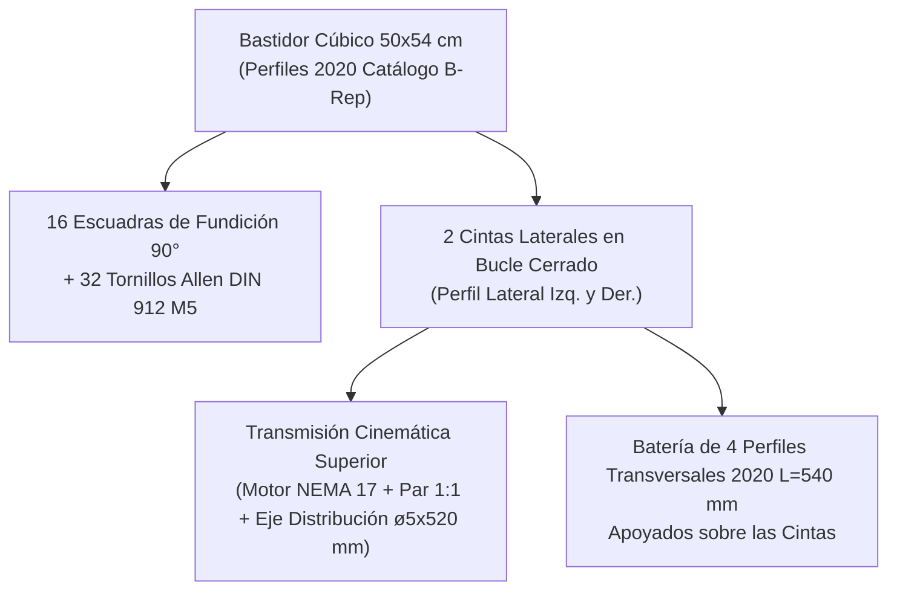

# 📑 Informe Técnico Profesional de Ingeniería - 04/11/2026 (En Progreso)

> **Proyecto:** Sistema Embebido de Control de Posición Bidireccional para Orientación de Prototipos Espaciales en Microgravedad Simulada  
> **Titulación:** Trabajo de Fin de Grado (TFG)  
> **Directorio de Trabajo Oficial:** [`DESARROLLO_TFG/`](file:///C:/Users/Usuario/Desktop/universidad/clase/TFG/DESARROLLO_TFG/)  
> **Fecha de Inicio de Sesión:** 4 de noviembre de 2026  
> **Modalidad Documental:** Informe Vivo Continuo e Incremental (actualizado en tiempo real)  
> **Documento:** `INFORME_2026_11_04_TRANSICION_INVENTOR_Y_LIMPIEZA.md`

---

## 1. Resumen Ejecutivo y Objetivos de la Sesión

1. **Reorganización Estructural del Espacio de Trabajo:**
   - Modularización del banco de ensayos en dos dominios claramente desacoplados: [`Parte mecanica/`](file:///C:/Users/Usuario/Desktop/universidad/clase/TFG/DESARROLLO_TFG/Parte%20mecanica/) y [`parte electrica/`](file:///C:/Users/Usuario/Desktop/universidad/clase/TFG/DESARROLLO_TFG/parte%20electrica/).
   - Plan de limpieza y archivo ordenado de archivos transitorios generados en etapas anteriores.
2. **Transición Oficial de CAD: Autodesk Fusion 360 $\to$ Autodesk Inventor Professional:**
   - Adopción de Autodesk Inventor como plataforma CAD principal para el diseño mecánico paramétrico, ensamblajes rígidos, cinemática y generación de planos de fabricación del TFG.
   - Evaluación e integración de la API de automatización de Autodesk Inventor (interfaz COM / ActiveX mediante Python y entornos de reglas iLogic).

---

## 2. Reestructuración de Espacio de Trabajo y Limpieza Ejecutada

### 2.1. Estado Actual de la Organización
Se ejecutó la separación modular y el plan de limpieza aprobado:
* [`parte electrica/ESP32/`](file:///C:/Users/Usuario/Desktop/universidad/clase/TFG/DESARROLLO_TFG/parte%20electrica/ESP32/): Aloja el firmware embebido de control y lectura del sensor joystick.
* [`Parte mecanica/`](file:///C:/Users/Usuario/Desktop/universidad/clase/TFG/DESARROLLO_TFG/Parte%20mecanica/):
  - [`Parte mecanica/Inventor/`](file:///C:/Users/Usuario/Desktop/universidad/clase/TFG/DESARROLLO_TFG/Parte%20mecanica/Inventor/): Directorio activo para proyectos (`.ipj`), piezas (`.ipt`) y ensamblajes (`.iam`).
  - [`Parte mecanica/fotos medidas/`](file:///C:/Users/Usuario/Desktop/universidad/clase/TFG/DESARROLLO_TFG/Parte%20mecanica/fotos%20medidas/): Archivo de cotas físicas reales de taller del bastidor 2020 ($500\text{ mm}$).
  - [`Parte mecanica/cad/`](file:///C:/Users/Usuario/Desktop/universidad/clase/TFG/DESARROLLO_TFG/Parte%20mecanica/cad/): Diseños paramétricos de piezas impresas en OpenSCAD.
  - [`Parte mecanica/historico_fusion/`](file:///C:/Users/Usuario/Desktop/universidad/clase/TFG/DESARROLLO_TFG/Parte%20mecanica/historico_fusion/): Depósito de scripts Python y modelos generados durante la etapa preliminar en Fusion 360, preservando los sólidos STEP neutros (`Marco_Real_2020_TFG.step`).

### 2.2. Evaluación Técnica de la Carpeta de Habilidades Externa (`prueba/`)
Se realizó una inspección técnica integral del contenido descargado en [`prueba/`](file:///C:/Users/Usuario/Desktop/universidad/clase/TFG/DESARROLLO_TFG/prueba/):
* **Origen:** Repositorio oficial `autodesk-platform-services/skills`.
* **Contenido evaluado:**
  1. `acad-arx-wizard`: Generador de código C++ ObjectARX específico para **AutoCAD 2027**.
  2. `acad-cuix-builder`: Constructor de barras y cintas de comandos CUIX para **AutoCAD**.
  3. `acad-dotnet`: Plantillas de desarrollo de plugins .NET dirigidas exclusivamente a **AutoCAD 2027**.
  4. `aps-docs-portal`: Navegación y consulta de APIs en la nube de Autodesk Platform Services (APS / Forge).
  5. `aps-mcp-server-gen`: Generador de servidores MCP para servicios web en la nube de APS.
  6. `flow-ptr-app`: Desarrollo de apps para la plataforma audiovisual Flow Production Tracking (ShotGrid).
* **Conclusión Técnica:** **Ninguna de las habilidades descargadas está orientada a Autodesk Inventor Desktop** (no cubren modelado 3D de piezas `.ipt`, ensamblajes `.iam`, restricciones cinemáticas, iLogic ni la interfaz COM de escritorio de Inventor). Por consiguiente, no aportan valor operativo al diseño mecánico del banco de pruebas y son prescindibles.

---

## 3. Estudio Técnico de la API de Autodesk Inventor

A diferencia de Fusion 360 (que ejecuta Python dentro de su propio runtime cerrado con el paquete `adsk`), Autodesk Inventor implementa una arquitectura cliente/servidor abierta basada en **COM (Component Object Model / ActiveX)** y **.NET**.

### 3.1. Vías de Control y Automatización Disponibles

1. **Automatización Externa mediante Python (`win32com.client` / `comtypes`):**
   - Permite controlar Autodesk Inventor desde scripts de Python externos en nuestro espacio de trabajo de forma idéntica a un operador humano o un servidor desatendido.
   - Conexión directa a la instancia activa:
     ```python
     import win32com.client
     inv_app = win32com.client.GetActiveObject("Inventor.Application")
     # O lanzamiento desatendido en background:
     # inv_app = win32com.client.Dispatch("Inventor.Application")
     # inv_app.Visible = True
     ```
   - Capacidad de crear bocetos 2D (`PlanarSketch`), operaciones de extrusión (`ExtrudeFeatures`), inserción de piezas normalizadas, cotas paramétricas y restricciones de ensamblaje (`Mate`, `Flush`, `Insert`, `Angle`).

2. **Entorno Nativo iLogic (VB.NET):**
   - Motor integrado en Inventor para diseño paramétrico basado en reglas declarativas.
   - Permite gobernar parámetros dimensionales (anchura de marco, longitudes de perfil, número de dientes de engranaje) con interfaz directa con tablas de parámetros (`Parameters`).

3. **Módulos Nativos de Ingeniería de Inventor (Design Accelerator & Frame Generator):**
   - **Generador de Estructuras (*Frame Generator*):** Permite generar el bastidor de aluminio 2020 directamente sobre un esqueleto alámbrico 3D, aplicando cortes a inglete automáticos a 45° o a tope a 90°.
   - **Generador de Engranajes Rectos (*Spur Gears Generator*):** Cálculo dinámico, cálculo de fatiga superficial según norma ISO 6336 / AGMA y modelado paramétrico sin anomalías de escala.
   - **Generador de Transmisión por Correa Síncrona (*Synchronous Belts Generator*):** Genera la trayectoria y poleas GT2 normalizadas calculando la longitud primitiva exacta de paso.

---

## 4. Implementación y Resultados: Modelado Mecatrónico Profesional en Autodesk Inventor 2027

### 4.1. Configuración del Proyecto Oficial (`.ipj`)
Siguiendo las mejores prácticas de la ingeniería CAD con Autodesk Inventor, se programó el script [`Parte mecanica/Inventor/scripts/generar_proyecto_ipj.py`](file:///C:/Users/Usuario/Desktop/universidad/clase/TFG/DESARROLLO_TFG/Parte%20mecanica/Inventor/scripts/generar_proyecto_ipj.py), creando y activando el proyecto:
* **Archivo de Proyecto:** [`Banco_Mecatronico_TFG.ipj`](file:///C:/Users/Usuario/Desktop/universidad/clase/TFG/DESARROLLO_TFG/Parte%20mecanica/Inventor/Banco_Mecatronico_TFG.ipj)
* **Modo:** `MultiUserModeEnum.kSingleUserMode`
* **Directorio Base de Búsqueda:** [`Parte mecanica/Inventor/`](file:///C:/Users/Usuario/Desktop/universidad/clase/TFG/DESARROLLO_TFG/Parte%20mecanica/Inventor/)

### 4.2. Catálogo Paramétrico de Piezas Individuales (`.ipt`)
A través del generador automatizado [`Parte mecanica/Inventor/scripts/generar_piezas_ipt.py`](file:///C:/Users/Usuario/Desktop/universidad/clase/TFG/DESARROLLO_TFG/Parte%20mecanica/Inventor/scripts/generar_piezas_ipt.py), utilizando la técnica de encadenamiento continuo de vértices (`EndSketchPoint` $\to$ `StartSketchPoint`) para garantizar perfiles estancos cerrados al 100%, se han generado las siguientes piezas en [`piezas/`](file:///C:/Users/Usuario/Desktop/universidad/clase/TFG/DESARROLLO_TFG/Parte%20mecanica/Inventor/piezas/):

| Pieza (.ipt) | Dimensiones Nominales | Función Mecatrónica en el Banco |
| :--- | :--- | :--- |
| [`Perfil_2020_L500.ipt`](file:///C:/Users/Usuario/Desktop/universidad/clase/TFG/DESARROLLO_TFG/Parte%20mecanica/Inventor/piezas/Perfil_2020_L500.ipt) | $20 \times 20\text{ mm}$, $L = 500\text{ mm}$ | 4 columnas verticales y 4 travesaños horizontales del marco cúbico de taller ($500\text{ mm}$ luz interior). |
| [`Perfil_2020_L540.ipt`](file:///C:/Users/Usuario/Desktop/universidad/clase/TFG/DESARROLLO_TFG/Parte%20mecanica/Inventor/piezas/Perfil_2020_L540.ipt) | $20 \times 20\text{ mm}$, $L = 540\text{ mm}$ | Carril guía transversal superior para el desplazamiento del carro móvil accionado por correa. |
| [`Perfil_2020_L600.ipt`](file:///C:/Users/Usuario/Desktop/universidad/clase/TFG/DESARROLLO_TFG/Parte%20mecanica/Inventor/piezas/Perfil_2020_L600.ipt) | $20 \times 20\text{ mm}$, $L = 600\text{ mm}$ | Perfiles longitudinales de la batería superior para avance de paneles (concepto SpaceX). |
| [`Escuadra_90_Fundicion_2020.ipt`](file:///C:/Users/Usuario/Desktop/universidad/clase/TFG/DESARROLLO_TFG/Parte%20mecanica/Inventor/piezas/Escuadra_90_Fundicion_2020.ipt) | $20 \times 20 \times 20\text{ mm}$, nervios $2{,}5\text{ mm}$, cajeado $15\text{ mm}$ | Unión angular rígida a 90° con colisos de ajuste para perfil 2020 según fotos de taller. |
| [`Tornillo_M5x8_DIN912.ipt`](file:///C:/Users/Usuario/Desktop/universidad/clase/TFG/DESARROLLO_TFG/Parte%20mecanica/Inventor/piezas/Tornillo_M5x8_DIN912.ipt) | Cabeza $\varnothing 8{,}5 \times 5\text{ mm}$, espiga $\varnothing 5 \times 8\text{ mm}$ | Tornillería Allen normalizada para fijación en ranuras en V con tuercas en T. |
| [`Rueda_VWheel_POM.ipt`](file:///C:/Users/Usuario/Desktop/universidad/clase/TFG/DESARROLLO_TFG/Parte%20mecanica/Inventor/piezas/Rueda_VWheel_POM.ipt) | $\varnothing 24{,}39\text{ mm}$, garganta V $90^\circ$, ancho $10{,}23\text{ mm}$ | Rodadura de bajo rozamiento sobre las ranuras del perfil 2020 (POM / rodamientos 625ZZ). |
| [`Carro_Transversal_Gantry.ipt`](file:///C:/Users/Usuario/Desktop/universidad/clase/TFG/DESARROLLO_TFG/Parte%20mecanica/Inventor/piezas/Carro_Transversal_Gantry.ipt) | Placa $65 \times 65 \times 5\text{ mm}$, extensión inferior $-25\text{ mm}$ | Placa base del carro con taladros $44 \times 40\text{ mm}$, soporte de sensor joystick y ojal para hilo. |
| [`Motor_NEMA17.ipt`](file:///C:/Users/Usuario/Desktop/universidad/clase/TFG/DESARROLLO_TFG/Parte%20mecanica/Inventor/piezas/Motor_NEMA17.ipt) | $42 \times 42 \times 40\text{ mm}$, piloto $\varnothing 22 \times 2\text{ mm}$, eje $\varnothing 5 \times 24\text{ mm}$ | Actuador electromecánico del eje transversal (ángulo de paso $1{,}8^\circ$, $200\text{ pasos/rev}$). |
| [`Engranaje_Recto_1a1_m1_Z20.ipt`](file:///C:/Users/Usuario/Desktop/universidad/clase/TFG/DESARROLLO_TFG/Parte%20mecanica/Inventor/piezas/Engranaje_Recto_1a1_m1_Z20.ipt) | $m = 1{,}0\text{ mm}$, $Z = 20$, $D_p = 20\text{ mm}$, $b = 7\text{ mm}$, eje $5\text{ mm}$ | Transmisión directa 1:1 entre motor NEMA 17 y eje de polea GT2 para $v = 0{,}5\text{ m/s}$ ($750\text{ rpm}$). |
| [`Polea_GT2_20T.ipt`](file:///C:/Users/Usuario/Desktop/universidad/clase/TFG/DESARROLLO_TFG/Parte%20mecanica/Inventor/piezas/Polea_GT2_20T.ipt) | $Z = 20$, paso $2\text{ mm}$, $D_p = 12{,}73\text{ mm}$, ancho diente $7\text{ mm}$ | Polea motriz de arrastre para correa síncrona GT2 ($40\text{ mm/vuelta}$). |
| [`Soporte_Motor_NEMA17_2020.ipt`](file:///C:/Users/Usuario/Desktop/universidad/clase/TFG/DESARROLLO_TFG/Parte%20mecanica/Inventor/piezas/Soporte_Motor_NEMA17_2020.ipt) | Placa $44 \times 64 \times 5\text{ mm}$, distancia entre centros $a = 20\text{ mm}$ | Soporte bi-eje para anclaje a perfil 2020 manteniendo el engrane preciso del par 1:1. |

### 4.3. Modelo Oficial del Cubo (50x54 cm) con Perfiles de Alta Calidad, Escuadras con 2 Tornillos y Cinemática Superior

Atendiendo a las correcciones e instrucciones detalladas del usuario junto con el croquis técnico manuscrito de fecha 04/11/2026, se ejecutó una refactorización geométrica integral del modelo en Autodesk Inventor 2027 a través de [`Parte mecanica/Inventor/scripts/generar_cubo_con_cintas.py`](file:///C:/Users/Usuario/Desktop/universidad/clase/TFG/DESARROLLO_TFG/Parte%20mecanica/Inventor/scripts/generar_cubo_con_cintas.py):



#### A. Calidad Geométrica y Sección Transversal Real del Perfil 2020
Se reemplazó la extrusión geométrica simplificada previa por el sólido paramétrico B-Rep fotorrealista de catálogo oficial ([`Perfil_2020_L500.ipt`](file:///C:/Users/Usuario/Desktop/universidad/clase/TFG/DESARROLLO_TFG/Parte%20mecanica/Inventor/piezas/Perfil_2020_L500.ipt), [`Perfil_2020_L540.ipt`](file:///C:/Users/Usuario/Desktop/universidad/clase/TFG/DESARROLLO_TFG/Parte%20mecanica/Inventor/piezas/Perfil_2020_L540.ipt) y [`Perfil_2020_L460.ipt`](file:///C:/Users/Usuario/Desktop/universidad/clase/TFG/DESARROLLO_TFG/Parte%20mecanica/Inventor/piezas/Perfil_2020_L460.ipt)), fiel a `Captura de pantalla 2026-10-28 191135.png`:
- Contorno exterior de $20 \times 20\text{ mm}$ con las 4 aristas exteriores redondeadas con radio $R = 1{,}5\text{ mm}$.
- Bocas de ranura de $6{,}0\text{ mm}$ con labios de $1{,}8\text{ mm}$ de espesor y chaflanes a $45^\circ$ para rodadura de ruedas V-Wheel.
- Cavidad interior ensanchada trapezoidal y almas diagonales de rigidización de $1{,}8\text{ mm}$.
- Núcleo central con taladro lobulado de 4 orejetas (*cloverleaf*) apto para roscado directo métrico M5.

#### B. Posicionamiento Enrasado de Escuadras de 90° y sus DOS Tornillos Allen M5
Se corrigió la orientación de las escuadras triangulares de fundición ([`Escuadra_90_Fundicion_2020.ipt`](file:///C:/Users/Usuario/Desktop/universidad/clase/TFG/DESARROLLO_TFG/Parte%20mecanica/Inventor/piezas/Escuadra_90_Fundicion_2020.ipt)) en las 16 esquinas de unión:
- Cada escuadra apoya de forma analíticamente estanca: su cara horizontal ($Z_{loc}=0$) enrasada contra la ranura superior/inferior del travesaño horizontal, y su cara vertical ($X_{loc}=0$) enrasada contra la columna vertical.
- En cada escuadra se insertan automáticamente sus **DOS tornillos Allen normalizados DIN 912 M5x8 con arandela ancha** ([`Tornillo_M5x8_DIN912.ipt`](file:///C:/Users/Usuario/Desktop/universidad/clase/TFG/DESARROLLO_TFG/Parte%20mecanica/Inventor/piezas/Tornillo_M5x8_DIN912.ipt)):
  $$\mathbf{M}_{tornillo,1} = \mathbf{M}_{escuadra} \cdot \mathbf{T}(10{,}5, 0, 3{,}0)$$
  $$\mathbf{M}_{tornillo,2} = \mathbf{M}_{escuadra} \cdot \mathbf{T}(3{,}0, 0, 10{,}5) \cdot \mathbf{R}_y(90^\circ)$$
- Total de fijaciones en el cubo: 16 escuadras de 90° y 32 tornillos M5 con arandela, visualmente verificados en sus cajeras y colisos.

#### C. Mecanismo de Tracción Superior (Croquis Oficial 04/11/2026)
Conforme al croquis manuscrito aportado por el usuario, se modeló e integró la cinemática de accionamiento superior:
1. **Dos Cintas Transportadoras en Bucle Cerrado (`Cinta_Transportadora_20mm_L500.ipt`):**
   - Montadas en los dos perfiles laterales superiores paralelos (Izquierdo $X = -260\text{ mm}$ y Derecho $X = +260\text{ mm}$).
   - Geometría de banda continua en bucle con dos ramales rectos y dos tramos semicilíndricos de curvatura sobre poleas de radio $r = 9{,}5\text{ mm}$ (distancia entre centros $L = 460\text{ mm}$).
2. **Tren de Engranajes Rectos 1:1 (`Engranaje_Recto_1a1_m1_Z20.ipt`):**
   - Módulo métrico $m = 1{,}0\text{ mm}$, número de dientes $Z_1 = Z_2 = 20$, diámetro primitivo $D_p = 20{,}0\text{ mm}$, ancho de cara $b = 7{,}0\text{ mm}$.
   - Distancia entre centros rigurosa $a = 20{,}0\text{ mm}$. Engranaje conducido montado coaxial al eje de la polea motriz izquierda, y engranaje conductor acoplado directamente al eje del motor NEMA 17.
3. **Motor Paso a Paso NEMA 17 (`Motor_NEMA17.ipt`):**
   - Situado en la esquina superior izquierda ($X = -282\text{ mm}, Y = 509{,}5\text{ mm}, Z = -230\text{ mm}$), con su eje ingresando en dirección $+X$ hacia el engranaje motor.
4. **Eje de Sincronización y Distribución Transversal (`Eje_Distribucion_5mm_L520.ipt`):**
   - Eje calibrado de $\varnothing 5{,}0\text{ mm} \times 520{,}0\text{ mm}$ de longitud, extendiéndose transversalmente desde $X = -260\text{ mm}$ hasta $X = +260\text{ mm}$.
   - Conecta solidariamente la polea motriz izquierda con la polea motriz derecha, garantizando el arrastre síncrono y simétrico de ambas cintas sin desfases angulares.

#### D. Batería de 4 Perfiles Transversales Apoyados
- 4 perfiles extruidos 2020 de longitud $L = 540\text{ mm}$ (`Perfil_2020_L540.ipt`).
- Apoyados directamente sobre el lomo superior de ambas cintas transportadoras ($Y_{apoyo} = 499{,}0\text{ mm}$, centro en $Y = 509{,}0\text{ mm}$), cruzando de $X = -270\text{ mm}$ a $X = +270\text{ mm}$.
- Espaciados equitativamente a lo largo del avance longitudinal en $Z$: $Z = -120\text{ mm}, -40\text{ mm}, +40\text{ mm}, +120\text{ mm}$.

---

## 5. Verificación Visual del Ensamblaje en Autodesk Inventor 2027

El ensamblaje oficial se encuentra guardado y activo en [`Parte mecanica/Inventor/ensamblajes/Banco_Mecatronico_Cubo_50x54.iam`](file:///C:/Users/Usuario/Desktop/universidad/clase/TFG/DESARROLLO_TFG/Parte%20mecanica/Inventor/ensamblajes/Banco_Mecatronico_Cubo_50x54.iam) y [`Banco_Mecatronico_TFG_Principal.iam`](file:///C:/Users/Usuario/Desktop/universidad/clase/TFG/DESARROLLO_TFG/Parte%20mecanica/Inventor/ensamblajes/Banco_Mecatronico_TFG_Principal.iam).

Se generaron las siguientes capturas fotorrealistas de validación:
1. **Vista Isométrica General:** [`cubo_completo_isometrica.png`](file:///C:/Users/Usuario/Desktop/universidad/clase/TFG/DESARROLLO_TFG/Parte%20mecanica/Inventor/ensamblajes/cubo_completo_isometrica.png)
2. **Vista Superior en Planta de la Batería:** [`cubo_completo_planta_bateria.png`](file:///C:/Users/Usuario/Desktop/universidad/clase/TFG/DESARROLLO_TFG/Parte%20mecanica/Inventor/ensamblajes/cubo_completo_planta_bateria.png)
3. **Vista de Conjunto Motor y Mecanismo:** [`cubo_completo_detalle_transmision.png`](file:///C:/Users/Usuario/Desktop/universidad/clase/TFG/DESARROLLO_TFG/Parte%20mecanica/Inventor/ensamblajes/cubo_completo_detalle_transmision.png)
4. **Detalle Primer Plano Escuadra con 2 Tornillos M5:** [`detalle_escuadra_y_tornillos_m5.png`](file:///C:/Users/Usuario/Desktop/universidad/clase/TFG/DESARROLLO_TFG/Parte%20mecanica/Inventor/ensamblajes/detalle_escuadra_y_tornillos_m5.png)
5. **Detalle Primer Plano Motor y Tren 1:1:** [`detalle_motor_engranajes_eje.png`](file:///C:/Users/Usuario/Desktop/universidad/clase/TFG/DESARROLLO_TFG/Parte%20mecanica/Inventor/ensamblajes/detalle_motor_engranajes_eje.png)

---

## 6. Automatización y Script Maestro

Se dispone de [`Parte mecanica/Inventor/scripts/generar_cubo_con_cintas.py`](file:///C:/Users/Usuario/Desktop/universidad/clase/TFG/DESARROLLO_TFG/Parte%20mecanica/Inventor/scripts/generar_cubo_con_cintas.py) que permite reconstruir y abrir de forma 100% determinista todo el proyecto CAD de Inventor con un único comando:
```powershell
python "Parte mecanica/Inventor/scripts/generar_cubo_con_cintas.py"
```

---

## 7. Próximos Pasos Técnicos

1. **Inspección Interactiva por el Usuario:** El usuario dispone del modelo completo abierto y visible en la interfaz gráfica de Autodesk Inventor 2027 para su revisión directa.
2. **Incorporación del Carro Móvil Gantry:** Montar el conjunto de placa de gantry con ruedas V-Wheel sobre uno de los perfiles transversales para sustentar el cable y péndulo de microgravedad.
3. **Integración con la Electrónica ESP32:** Conectar las órdenes de accionamiento del driver TMC2209 con el motor NEMA 17 para el avance de las cintas.

