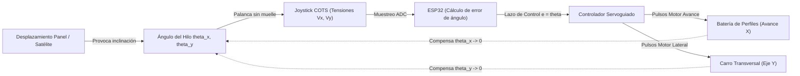

# Diseño Técnico: Sistema Mecatrónico de Despliegue y Seguimiento Angular con Joystick y ESP32

## Contexto

Ver motivación y objetivos funcionales en [`proposal.md`](file:///C:/Users/Usuario/Desktop/universidad/clase/TFG/27_10_26/openspec/changes/despliegue-satelites-joystick-esp32/proposal.md).
El modelo mecánico actual en Autodesk Fusion 360 ([`Ensamblaje_TFG.f3z`](file:///C:/Users/Usuario/Desktop/universidad/clase/TFG/27_10_26/Fusion/Ensamblaje_TFG.f3z)) consta de un único marco vertical cerrado formado por perfiles de aluminio V-Slot/T-Slot (dimensiones base según modelo). Para emular la eyección secuencial de paneles/satélites en despliegue espacial tipo SpaceX, la estructura superior debe evolucionar a un puente/batería de perfiles bidireccional cartesianos gobernados por un microcontrolador ESP32.

---

## Objetivos / No Objetivos (Goals / Non-Goals)

**Objetivos:**
- Diseñar la arquitectura mecatrónica de la bancada superior en Fusion 360 incorporando:
  1. Una batería de perfiles longitudinales en la parte superior que avancen coordinados con la suelta de paneles.
  2. Un carro transversal compacto con micromotor que se mueva de izquierda a derecha a lo largo del perfil.
- Implementar en el ESP32 la adquisición continua del sensor joystick comercial COTS para medir la deflexión angular ($\theta_x, \theta_y$) del hilo de sujeción.
- Asegurar el desacoplo estructural de carga para que el peso del satélite ($m_s = 0{,}35\text{ kg}$, $P \approx 3{,}43\text{ N}$) no dañe ni sobrecargue los pivotes del joystick comercial.

**No Objetivos:**
- Modificar el diseño aerodinámico o estructural interno del CubeSat.
- Sustituir la electrónica principal de potencia del banco sin antes consensuar interfaces eléctricas y drivers.

---

## Fundamento Físico y Matemático del Control

### Relación Cinemática y Fuerza Perturbadora
Si el satélite se desplaza respecto a la vertical una distancia $\Delta x$, con una longitud de cable $L = 0{,}60\text{ m}$:
$$\sin\theta \approx \theta = \frac{x_{sat} - x_{carro}}{L}$$

La fuerza perturbadora en el plano horizontal es:
$$F_x = m_s g \sin\theta \approx m_s g \cdot \frac{x_{sat} - x_{carro}}{L}$$

Para mantener la microgravedad emulada sin aceleraciones ficticias ($F_x \to 0$), la ley de control busca hacer $x_{carro} = x_{sat}$, anulando el error angular:
$$e(t) = \theta(t) \to 0$$

---

## Decisiones de Diseño

### Decisión 1: Joystick Comercial COTS de Bajo Rozamiento
- **Opción seleccionada:** Módulo joystick comercial analógico COTS (o gimbal miniatura de 2 ejes).
- **Justificación:** Rapidez de integración y bajo coste.
- **Detalle de integración:** Para evitar que la fuerza del muelle de retorno falsee la caída del hilo ($F_{muelle} \gg F_{hilo}$), se retirará el muelle interno de centrado o se utilizará un gimbal tipo radiocontrol con tornillo de ajuste de fricción a cero.
- **Alternativas consideradas:**
  - Mecanismo 3D propio con rodamientos y sensores magnéticos AS5600 (descartado temporalmente por preferencia del usuario de comprarlo comercial).

### Decisión 2: Desacoplo Mecánico de Carga del Cable
- **Solución:** El hilo no cuelga de la palanca del joystick. El hilo se fija rígidamente a una pieza estructural del carro transversal. Inmediatamente debajo, el hilo atraviesa un anillo/ojal solidario a la palanca del joystick. Al inclinarse el hilo, empuja suavemente el anillo sin transferir tracción axial.

### Decisión 3: Arquitectura de la Batería Superior en Fusion 360
- **Estructura:** Sobre el marco vertical existente, se añaden 2 o más perfiles longitudinales superiores (batería de perfiles) en voladizo o sustentados en pórtico, sirviendo de raíles guía para el avance sincronizado con la eyección de satélites.
- **Carro transversal:** Carro rodante sobre ruedas V-wheel o guía lineal con micromotor acoplado por polea/correa o cremallera para el movimiento izquierda-derecha.

---

## Riesgos y Mitigaciones

| Riesgo | Impacto | Mitigación |
| :--- | :--- | :--- |
| **Zona muerta o fricción en el joystick COTS** | El carro no detecta inclinaciones muy leves ($< 0{,}2^\circ$) | Calibrar filtrado paso bajo en ESP32 y seleccionar joystick con potenciómetros lineales de baja resistencia mecánica o efecto Hall |
| **Pérdida de pasos en el motor transversal** | Desalineación del carro | Incluir finales de carrera de referencia (*homing*) en los extremos del perfil |
| **Flexión de los perfiles en voladizo** | Desviación del plano horizontal | Escuadras trianguladas de refuerzo en los nodos de unión con el marco |

---

## 📐 Especificaciones Dimensionales Reales Verificadas (28/10/2026)

A partir del levantamiento fotográfico y dimensional aportado por el usuario en `fotos medidas/`:

1. **Marco Portal Existente:**
   - **Perfil estructural:** Aluminio extrusionado V-Slot / T-Slot serie **2020** ($20\text{ mm} \times 20\text{ mm}$, ranura de $6\text{ mm}$).
   - **Perfiles verticales:** 2 barras de longitud $500\text{ mm}$ ($50\text{ cm}$).
   - **Luz horizontal interior:** $500\text{ mm}$ ($50\text{ cm}$) entre caras internas de los montantes verticales.
   - **Ancho exterior total:** $540\text{ mm}$ ($54\text{ cm}$) considerando el solape de los perfiles laterales ($20 + 500 + 20\text{ mm}$).
   - **Uniones de esquina:** Escuadras angulares de 90° de fundición de aluminio para perfil 2020 con tornillería M4/M5 y tuercas T.

2. **Sistema de Transmisión del Carro Transversal (Eje Y / Izquierda-Derecha):**
   - **Tipo de accionamiento:** Correa dentada síncrona tipo impresora 3D (**Correa GT2**, ancho $6\text{ mm}$, paso $p = 2\text{ mm}$, alma de fibra de vidrio/neopreno).
   - **Actuador:** Motor paso a paso (NEMA 17 / NEMA 14, ángulo de paso $1{,}8^\circ$, 200 pasos/vuelta).
   - **Polea motriz:** Polea dentada GT2 de 20 dientes ($Z = 20$), avance lineal de $40\text{ mm/vuelta}$ ($2\text{ mm} \times 20$).
   - **Polea de reenvío/tensado:** Polea loca con rodamientos (idler liso/dentado GT2) montada en el extremo opuesto del perfil.
   - **Guiado del carro:** Carro deslizante sobre ruedas V-Wheel de POM con rodamientos 625ZZ en las ranuras del perfil 2020 (o casquillos lineales sobre varilla guía).
   - **Sujeción de correa:** Mordaza de anclaje (*belt clamp*) integrada en el chasis del carrito para fijar ambos extremos de la correa GT2 abierta.

3. **Batería Superior de Avance Longitudinal (Eje X):**
   - Batería de perfiles paralelos que avanzan coordinadamente en profundidad a la par que la columna de paneles satelitales (simulación SpaceX).
   - El puente superior móvil traslada la bancada transversal, logrando un espacio de trabajo cartesiano $X-Y$ servoguiado por el ESP32.

---

## Decisiones de Diseño Actualizadas

### Decisión 1: Transmisión por Correa GT2 frente a Husillo en Carro Transversal
- **Opción seleccionada:** Correa dentada GT2 de 6 mm con polea GT2-20T y motor paso a paso.
- **Justificación técnica:** 
  - La correa GT2 ofrece una velocidad lineal significativamente superior a un husillo ($> 300\text{ mm/s}$ frente a $\approx 30\text{ mm/s}$ en husillo T8), indispensable para que el carro superior reaccione con rapidez instantánea ante oscilaciones del péndulo de $f_n = 0{,}6435\text{ Hz}$ ($T_n \approx 1{,}55\text{ s}$).
  - Cero juego mecánico (*backlash*) bajo pretensado elástico.
  - Masa suspendida sobre el pórtico reducida al mínimo.

### Decisión 2: Resolución Cinemática del Carro Transversal
Con motor paso a paso de $1{,}8^\circ$ (200 pasos/rev), polea GT2-20T ($40\text{ mm/rev}$) y micropasos en driver TMC2209/A4988 a 16 micropasos:
$$\text{Resolución} = \frac{40\text{ mm}}{200 \times 16} = \frac{40}{3200} = 0{,}0125\text{ mm/micropaso} \quad (12{,}5\,\mu\text{m})$$
Esta resolución milimétrica es más de 10 veces superior a la precisión requerida para corregir desviaciones angulares de $\theta = 0{,}05^\circ$ ($0{,}52\text{ mm}$ a $L = 600\text{ mm}$).

