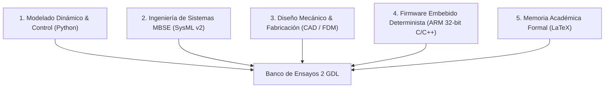
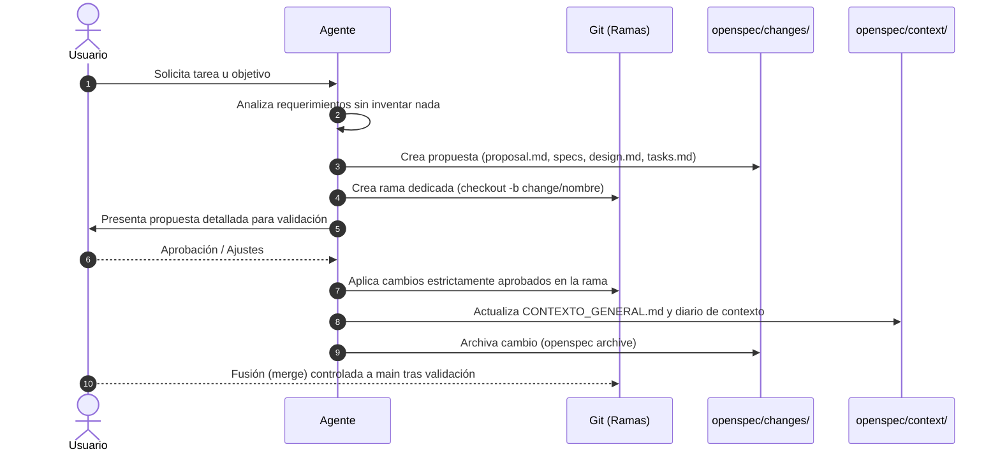

# 🛰️ Contexto General del Proyecto (TFG)

> **Documento:** Resumen Ejecutivo y Marco Técnico Permanente  
> **Ubicación:** `openspec/context/CONTEXTO_GENERAL.md`  
> **Proyecto:** Sistema Embebido de Control de Posición Bidireccional para Orientación de Prototipos Espaciales en Microgravedad Simulada  
> **Titulación:** Trabajo de Fin de Grado (TFG)  
> **Directorio:** `DESARROLLO_TFG`  
> **Última actualización:** 03/11/2026  

---

## 📌 1. Visión y Propósito General

El presente Trabajo de Fin de Grado (TFG) aborda el diseño, modelado, fabricación y control de un banco de ensayos mecatrónico cartesiano de 2 Grados de Libertad ($X$ y $Z$). Su propósito es emular condiciones de microgravedad y permitir la orientación y posicionamiento controlado de prototipos espaciales (CubeSats) suspendidos mediante cable, mitigando las oscilaciones pendulares mediante técnicas avanzadas de conformado de comandos (*Input Shaping*).

---

## 🛑 2. Reglas Operativas Fundamentales (Inviolables)

1. **Cero Invención (Antialucinación) y Consulta Obligatoria:** Prohibido inventar datos, supuestos, fórmulas, componentes, tolerancias o bibliografía. Obligación inexcusable de consultar y preguntar directamente al usuario ante cualquier duda o incertidumbre en valores numéricos, medidas, carreras, cargas, tolerancias o especificaciones. Jamás asumir o inferir datos no confirmados.
2. **Subordinación Total al Usuario:** Ningún cambio de diseño, arquitectura, fichero o implementación se realiza de manera autónoma sin propuesta previa y visto bueno explícito del usuario.
3. **Flujo de Trabajo Estricto con OpenSpec:** Toda nueva funcionalidad, módulo o cambio debe articularse mediante propuestas OpenSpec (`proposal.md`, especificaciones delta en `specs/`, diseño en `design.md` y tareas en `tasks.md`), garantizando la trazabilidad y la retención del contexto día a día.
4. **Actualización Continua del Contexto:** Al finalizar o modificar un bloque de trabajo, este documento y el registro diario deben actualizarse para que las sesiones futuras mantengan la coherencia total del proyecto.
5. **Informe Profesional Continuo e Incremental (en tiempo real):** Prohibido esperar al final del día. El informe técnico profesional en [`informes/`](file:///C:/Users/Usuario/Desktop/universidad/clase/TFG/DESARROLLO_TFG/informes/) se genera y actualiza continuamente conforme se trabaja y se alcanzan avances, registrando código, diagramas, justificación físico-matemática y decisiones para garantizar que jamás se pierda el registro por olvido o interrupción de sesión.
6. **Prohibición Estricta de Trabajar en Main (Git Branching Obligatorio):** Jamás se trabaja directamente en la rama `main`. Cada propuesta de cambio de OpenSpec debe desarrollarse en su propia rama dedicada (ej. `change/<nombre-cambio>`). La integración con `main` solo se hace tras visto bueno explícito y archivado del cambio.
7. **Protocolo Obligatorio de Backups:** El espacio de trabajo permanente es `DESARROLLO_TFG`. Al cierre de cada jornada o bajo demanda, se genera un respaldo completo en `backups/backup_YYYY_MM_DD`. Todas las sesiones anteriores se conservan en `backups/`.

---

## 📐 3. Parámetros Físicos y Cinematocátricos Base

*(Valores nominales validados; cualquier ajuste requiere aprobación del usuario)*

| Parámetro | Símbolo | Valor Nominal | Unidades / Notas |
| :--- | :---: | :---: | :--- |
| **Longitud del cable de suspensión** | $L$ | $0{,}60$ | $\text{m}$ ($600\text{ mm}$) |
| **Masa del prototipo suspendido** | $m_s$ | $0{,}35$ | $\text{kg}$ ($350\text{ g}$, estándar CubeSat) |
| **Aceleración de la gravedad** | $g$ | $9{,}81$ | $\text{m/s}^2$ |
| **Frecuencia natural angular** | $\omega_n$ | $4{,}0435$ | $\text{rad/s}$ ($\omega_n = \sqrt{g/L}$) |
| **Período natural de oscilación** | $T_n$ | $1{,}5539$ | $\text{s}$ ($T_n = 2\pi / \omega_n$) |
| **Frecuencia natural cíclica** | $f_n$ | $0{,}6435$ | $\text{Hz}$ |
| **Factor de amortiguamiento viscoso** | $\zeta$ | $0{,}015$ | Estimación aerodinámica en aire |
| **Retardo entre impulsos ZV** | $\Delta t_{ZV}$ | $0{,}777$ | $\text{s}$ ($\Delta t = T_n / 2$) |
| **Amplitud relativa de impulsos ZV** | $A_1, A_2$ | $A_1 \approx 0{,}5038$, $A_2 \approx 0{,}4962$ | $A_1 = \frac{1}{1+K}$, $A_2 = \frac{K}{1+K}$, $K=e^{\frac{-\zeta\pi}{\sqrt{1-\zeta^2}}}$ |

### Requisitos y Criterios de Rendimiento
- **Desviación angular máxima admisible durante traslación:** $\phi \le 0{,}5^\circ$.
- **Vibración residual objetivo tras parada:** $\phi_{residual} \le 0{,}05^\circ$ (teóricamente $0{,}0^\circ$ con filtro ZV sintonizado).
- **Recorridos mínimos útiles:** Eje horizontal $X \ge 300\text{ mm}$; Eje vertical $Z \ge 500\text{ mm}$.
- **Seguridad en parada de emergencia:** Tiempo de respuesta $< 10\text{ ms}$, finales de carrera en lógica normalmente cerrada (NC / *fail-safe*).

---

## 🏗️ 4. Los Cinco Pilares Técnicos del Proyecto

### 4.1. Modelado Dinámico y Control (Python / SciPy)
- Formulación de ecuaciones diferenciales de movimiento acopladas de Euler-Lagrange para carro-péndulo en 2 GDL.
- Generación de perfiles cinemáticos suaves (curvas en S y trapezoidales) y convolución temporal con filtros de conformado de entrada (*Input Shaping* ZV y ZVD).
- Validación y contraste entre dinámica linealizada y no lineal mediante integración numérica (`scipy.integrate.solve_ivp`).

### 4.2. Ingeniería de Sistemas Basada en Modelos (SysML v2 / Eclipse SysON)
- Trazabilidad formal de requisitos (`req_gravedad`, `req_vibracion`, `req_carreras`, `req_seguridad`).
- Modelado estructural de bloques, puertos de flujo (fuerza, par, señal eléctrica, comunicación UART) y jerarquía de subsistemas.
- Máquina de estados finitos (FSM) que modela los modos de operación: Inicialización, Homing, Reposo (*Idle*), Movimiento con *Input Shaping* y Parada de Emergencia.

### 4.3. Diseño Mecánico y Fabricación Aditiva (CAD / FDM)
- Bastidor con perfiles de aluminio estructural (series 2020/2040) y cálculo analítico de deflexión máxima ($\delta \le 0{,}05\text{ mm}$).
- Transmisión por husillos trapezoidales T8x8 (avance $8\text{ mm/vuelta}$, 4 entradas) con tuercas *anti-backlash*.
- Piezas de soporte e interfaz optimizadas para impresión 3D FDM (tolerancias nominales: $+0{,}35\text{ mm}$ en holguras de ejes, $+0{,}18\text{ mm}$ en rodamientos tipo 608ZZ, desahogos cónicos para insertos de latón).

### 4.4. Firmware Embebido Determinista (C/C++ para ARM de 32 bits)
- Plataforma objetivo: Microcontroladores ARM Cortex-M (ej. SAM3X8E / STM32 / RP2040).
- Generación de pulsos de paso (`STEP`) gobernada exclusivamente por temporizadores e interrupciones hardware (*Timer ISR*) con *jitter* $< 1\,\mu\text{s}$, prohibiendo funciones bloqueantes (`delay()`).
- Control de drivers inteligentes Trinamic TMC2209 mediante bus serie UART: configuración en modo silencioso `StealthChop2` (eliminación de armónicos de vibración) y 16 micropasos con interpolación interna a 256.

### 4.5. Memoria Académica Formal (LaTeX)
- Estructura modular estricta compilable con `pdflatex` y `biber`.
- Tipografía técnica según normas internacionales empleando `siunitx` y tablas de alta calidad con `booktabs`.
- Base de datos bibliográfica BibLaTeX con referencias científicas contrastadas (IEEE, AIAA, ASME, Singer, Seering).

---

## 🔄 5. Metodología de Gestión y Flujo con OpenSpec

Para mantener el control y preservar el contexto histórico día a día, toda iniciativa de desarrollo seguirá el ciclo OpenSpec:

1. **Exploración / Propuesta (`openspec new change <nombre>`):** Se redacta la propuesta formal explicando el *qué*, el *por qué*, las especificaciones técnicas delta, el diseño propuesto y el desglose de tareas.
2. **Creación de Rama Git Dedicada:** Se crea y conmuta a una rama nueva (`git checkout -b change/<nombre-cambio>`). **Prohibido tocar `main`**.
3. **Revisión y Aprobación del Usuario:** El usuario revisa y autoriza expresamente antes de tocar código o documentos finales.
4. **Aplicación (`opsx apply`):** Se implementan las tareas una a una con validación y pruebas inmediatas dentro de la rama.
5. **Sincronización y Archivado (`openspec archive` / `sync`):** Se consolidan las especificaciones en `openspec/specs/` y se actualiza el diario de contexto.
6. **Fusión a `main`:** Solo tras completar y validar la propuesta, y con el consentimiento explícito del usuario.

---

## 📅 6. Registro Cronológico de Sesiones y Contexto Acumulado

### Sesión 26/10/2026 (Sesión de Apertura del Espacio de Trabajo)
- **Hitos completados:**
  - Creación de [`AGENTS.md`](file:///C:/Users/Usuario/Desktop/universidad/clase/TFG/27_10_26/AGENTS.md) estableciendo las reglas inviolables de cero invención, control absoluto por parte del usuario y lectura obligatoria al inicio de cada sesión.
  - Creación del repositorio de contextos en `openspec/context/` y redacción de este documento [`CONTEXTO_GENERAL.md`](file:///C:/Users/Usuario/Desktop/universidad/clase/TFG/27_10_26/openspec/context/CONTEXTO_GENERAL.md).
  - Adopción obligatoria de la metodología OpenSpec para todas las propuestas y evoluciones técnicas del proyecto.
  - Creación del directorio [`informes/`](file:///C:/Users/Usuario/Desktop/universidad/clase/TFG/27_10_26/informes/) y establecimiento del protocolo de emisión de informes profesionales diarios de ingeniería con código, gráficas y justificación académica.
  - Adopción obligatoria de la regla de Git: **Prohibición absoluta de trabajar en `main`**, exigiendo una rama nueva dedicada para cada cambio de OpenSpec.

### Sesión 27/10/2026
- **Hitos completados:**
  - Inicialización del repositorio Git local y creación de rama `change/despliegue-satelites-joystick-seguimiento`.
  - Actualización de `AGENTS.md` y `openspec/config.yaml` incorporando la regla mandatoria de consulta obligatoria ante cualquier duda de medidas o valores.
  - Formulación formal de la propuesta OpenSpec `despliegue-satelites-joystick-esp32` con sus 4 artefactos aprobados y validados.
  - Reestructuración de `TFG/`: `DESARROLLO_TFG/` como espacio de trabajo permanente y `backups/` como histórico con script `backup.ps1`.
  - Adopción de la regla de **Informe Profesional Continuo e Incremental**: redactar y editar el informe en tiempo real conforme se trabaja, sin esperar al cierre de jornada.

### Sesión 28/10/2026
- **Hitos completados:**
  - **Levantamiento métrico real de taller:** Verificación del perfil 2020, marco base $500\text{ mm}$ de luz interior, $540\text{ mm}$ exterior y $500\text{ mm}$ de altura.
  - **Cinemática de carro transversal:** Decisión de tracción por correa síncrona GT2 ($2\text{ mm}$ paso, avance $40\text{ mm/vuelta}$) con motor paso a paso fijo en extremo lateral y guiado por ruedas V-Wheel de POM con espaciadores excéntricos.
  - **Artefactos 3D generados:** Soportes en OpenSCAD (`soporte_motor_nema17_2020.scad`, `soporte_tensor_idler_2020.scad`, `carro_movil_vwheel_joystick.scad`) con desacoplo de carga del hilo.
  - **Integración oficial con Autodesk Fusion 360:** Script y add-in `GenerarBancoTFG`, exportación B-Rep oficial `Marco_Real_2020_TFG.step`, `Banco_Mecatronico_TFG.step`, modelos OBJ/STL y visor interactivo WebGL (`visor_3d_fusion.html`).
  - **Croquis cinemático global:** Recepción del croquis isométrico definiendo el eje de distribución de par frontal motorizado (Motor 1) para avance del puente y carro transversal (Motor 2).

### Sesión 03/11/2026
- **Hitos completados:**
  - **Arquitectura de control del ESP32:** Definición del control de giro bidireccional (CW/CCW) mediante pines `DIR` y `STEP` para el lazo servoguiado.
  - **Selección del Driver de Potencia:** Evaluación técnica comparativa (TMC2209, TMC2208, A4988, DRV8825). Selección del **TMC2209** por su tecnología *StealthChop2* con interpolación a 256 micropasos, esencial para evitar que los armónicos del motor exciten la frecuencia del péndulo ($f_n \approx 0{,}64\text{ Hz}$).
  - **Cálculo dinámico para velocidad lineal $v = 0{,}5\text{ m/s}$:**
    - Régimen de giro de polea GT2-20T ($40\text{ mm/vuelta}$): $n = 750\text{ rpm}$ ($12{,}5\text{ rev/s}$).
    - Par resistente estimado para aceleración deportiva ($a = 2\text{ m/s}^2$): $\tau \approx 0{,}022\text{ N}\cdot\text{m}$.
    - Verificación con NEMA 17 estándar ($T_H \approx 0{,}40 - 0{,}45\text{ N}\cdot\text{m}$): A $750\text{ rpm}$ entrega $\approx 0{,}12\text{ N}\cdot\text{m}$ (factor de seguridad $> 5$).
  - **Diseño del tren de engranajes rectos en Fusion 360:**
    - Corrección de la anomalía de módulo imperial de Fusion 360 (`Module 12.70` $\to D_p = 304{,}8\text{ mm}$).
    - Adopción de **relación directa 1:1** ($Z_1 = 20, Z_2 = 20$, módulo $m = 1{,}0\text{ mm}$) para mantener el motor a $750\text{ rpm}$ y evitar el calado por sobrevelocidad que provocaría una reductora.
    - Consolidación de parámetros: $m = 1{,}0\text{ mm}$, $Z = 20$, ángulo de presión $20^\circ$, *backlash* $0{,}20\text{ mm}$, espesor $b = 7{,}00\text{ mm}$, taladro de eje $5{,}00\text{ mm}$ y distancia entre centros $a = 20{,}00\text{ mm}$.
  - **Documentación continua:** Emisión y actualización en tiempo real de [`informes/INFORME_2026_11_03_DISENO_TRANSMISION_MOTOR_ESP32.md`](file:///C:/Users/Usuario/Desktop/universidad/clase/TFG/DESARROLLO_TFG/informes/INFORME_2026_11_03_DISENO_TRANSMISION_MOTOR_ESP32.md).

### Sesión 04/11/2026 (Sesión Actual)
- **Hitos completados:**
  - **Reorganización modular del espacio de trabajo:** Desacoplo estructural entre [`Parte mecanica/`](file:///C:/Users/Usuario/Desktop/universidad/clase/TFG/DESARROLLO_TFG/Parte%20mecanica/) y [`parte electrica/`](file:///C:/Users/Usuario/Desktop/universidad/clase/TFG/DESARROLLO_TFG/parte%20electrica/). Reubicación del firmware del ESP32 en el dominio eléctrico y archivado limpio del entorno anterior en [`Parte mecanica/historico_fusion/`](file:///C:/Users/Usuario/Desktop/universidad/clase/TFG/DESARROLLO_TFG/Parte%20mecanica/historico_fusion/).
  - **Depuración de dependencias externas:** Inspección y purga de la carpeta transitoria `prueba/` tras verificar que no contenía componentes para Inventor Desktop.
  - **Transición Oficial a Autodesk Inventor Professional 2027:**
    - Configuración y activación del proyecto oficial de Autodesk Inventor [`Banco_Mecatronico_TFG.ipj`](file:///C:/Users/Usuario/Desktop/universidad/clase/TFG/DESARROLLO_TFG/Parte%20mecanica/Inventor/Banco_Mecatronico_TFG.ipj).
    - Descubrimiento e integración del binding oficial de C++ de Autodesk [`adsk.inventor`](file:///C:/Program%20Files/Autodesk/Inventor%202027/Bin/PythonBindings/adsk/inventor) para automatización directa sin dependencias externas.
  - **Generación Paramétrica del Catálogo de Piezas (.ipt):**
    - Suite Python [`generar_piezas_ipt.py`](file:///C:/Users/Usuario/Desktop/universidad/clase/TFG/DESARROLLO_TFG/Parte%20mecanica/Inventor/scripts/generar_piezas_ipt.py) con encadenamiento de vértices hermético:
      - Perfiles 2020 V-Slot parametrizados ($L = 500\text{ mm}, 540\text{ mm}, 600\text{ mm}$).
      - Escuadra de 90° de fundición con nervios laterales y colisos M5 ($20 \times 20 \times 20\text{ mm}$).
      - Tornillería Allen DIN 912 M5x8.
      - Ruedas V-Wheel de POM con perfil a 90°.
      - Placa Gantry del carro transversal ($65 \times 65\text{ mm}$) con soporte de sensor joystick y ojal para hilo.
      - Motor NEMA 17 ($42 \times 42 \times 40\text{ mm}$, eje $\varnothing 5\text{ mm}$).
      - Engranajes rectos de evolvente 1:1 ($Z = 20, m = 1{,}0\text{ mm}, b = 7\text{ mm}$).
      - Polea síncrona GT2 de 20 dientes ($D_p = 12{,}73\text{ mm}$).
      - Soporte bi-eje para NEMA 17 con distancia entre centros $a = 20{,}0\text{ mm}$.
  - **Construcción del Modelo Oficial del Cubo (50x54 cm) en Autodesk Inventor 2027:**
    - Script Python maestro [`generar_cubo_con_cintas.py`](file:///C:/Users/Usuario/Desktop/universidad/clase/TFG/DESARROLLO_TFG/Parte%20mecanica/Inventor/scripts/generar_cubo_con_cintas.py):
      - **Geometría de alta fidelidad:** Sustitución de extrusiones simples por perfiles 2020 de catálogo B-Rep con contorno exterior redondeado ($R=1{,}5\text{ mm}$), ranuras V-Slot a $45^\circ$, núcleo lobulado *cloverleaf* M5 y nervios internos.
      - **Escuadras enrasadas con tornillería completa:** 16 escuadras de fundición de 90° con sus caras horizontales y verticales perfectamente enrasadas contra las ranuras de los perfiles, integrando **32 tornillos Allen DIN 912 M5x8 con arandela** (2 tornillos por escuadra) alojados analíticamente en sus colisos.
      - **Cinemática superior (croquis 04/11/2026):** Dos cintas en bucle cerrado sobre los perfiles laterales superiores, accionadas por motor NEMA 17 acoplado mediante tren de engranajes rectos 1:1 ($Z_1=Z_2=20, m=1{,}0\text{ mm}, a=20{,}0\text{ mm}$) y eje de distribución transversal de $\varnothing 5\text{ mm} \times 520\text{ mm}$ que sincroniza ambas poleas motrices GT2.
      - **Batería móvil apoyada:** 4 perfiles transversales 2020 de $540\text{ mm}$ apoyados directamente sobre la cara superior de ambas cintas ($Y = 500\text{ mm}$), espaciados uniformemente en $Z$.
      - **Alineación de coordenadas:** Orientación oficial con eje $Y$ vertical hacia arriba (*Y-up*), garantizando congruencia visual con el ViewCube y vistas ortogonales de Autodesk Inventor.
    - Modelos consolidados: [`Banco_Mecatronico_Cubo_50x54.iam`](file:///C:/Users/Usuario/Desktop/universidad/clase/TFG/DESARROLLO_TFG/Parte%20mecanica/Inventor/ensamblajes/Banco_Mecatronico_Cubo_50x54.iam) y [`Banco_Mecatronico_TFG_Principal.iam`](file:///C:/Users/Usuario/Desktop/universidad/clase/TFG/DESARROLLO_TFG/Parte%20mecanica/Inventor/ensamblajes/Banco_Mecatronico_TFG_Principal.iam).
  - **Documentación continua:** Emisión y actualización en tiempo real de [`informes/INFORME_2026_11_04_TRANSICION_INVENTOR_Y_LIMPIEZA.md`](file:///C:/Users/Usuario/Desktop/universidad/clase/TFG/DESARROLLO_TFG/informes/INFORME_2026_11_04_TRANSICION_INVENTOR_Y_LIMPIEZA.md).

- **Estado actual:**
  - Modelo CAD completamente consolidado y verificado en Autodesk Inventor Professional 2027. Cubo de $50 \times 54\text{ cm}$ con perfiles de catálogo B-Rep, 16 escuadras con sus 32 tornillos M5, 2 cintas cerradas con motor NEMA 17, engranajes 1:1, eje de sincronización y batería de 4 perfiles apoyados. Abierto y visible en directo en la interfaz de Autodesk Inventor 2027.
