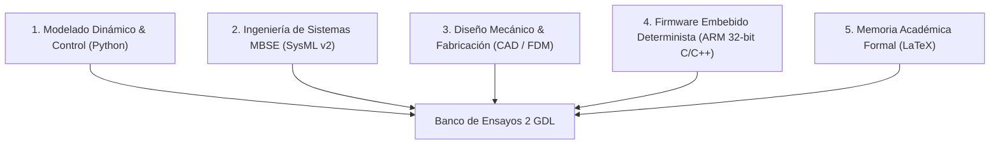
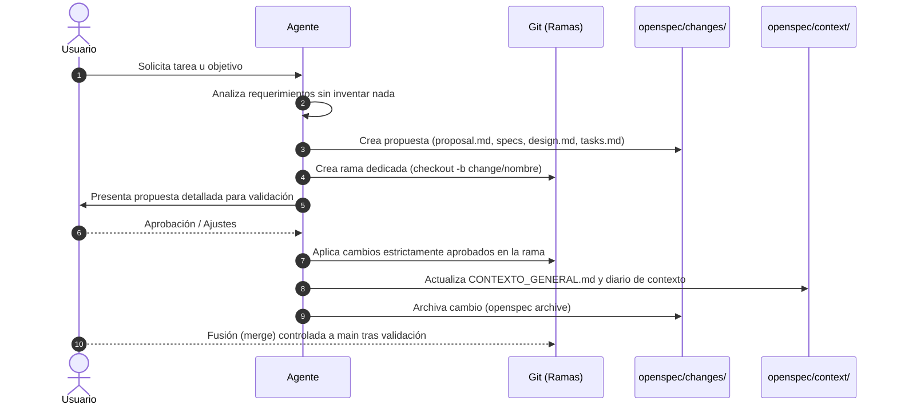

# 🛰️ Contexto General del Proyecto (TFG)

> **Documento:** Resumen Ejecutivo y Marco Técnico Permanente  
> **Ubicación:** `openspec/context/CONTEXTO_GENERAL.md`  
> **Proyecto:** Sistema Embebido de Control de Posición Bidireccional para Orientación de Prototipos Espaciales en Microgravedad Simulada  
> **Titulación:** Trabajo de Fin de Grado (TFG)  
> **Directorio:** `27_10_26`  
> **Última actualización:** 27/10/2026  

---

## 📌 1. Visión y Propósito General

El presente Trabajo de Fin de Grado (TFG) aborda el diseño, modelado, fabricación y control de un banco de ensayos mecatrónico cartesiano de 2 Grados de Libertad ($X$ y $Z$). Su propósito es emular condiciones de microgravedad y permitir la orientación y posicionamiento controlado de prototipos espaciales (CubeSats) suspendidos mediante cable, mitigando las oscilaciones pendulares mediante técnicas avanzadas de conformado de comandos (*Input Shaping*).

---

## 🛑 2. Reglas Operativas Fundamentales (Inviolables)

1. **Cero Invención (Antialucinación) y Consulta Obligatoria:** Prohibido inventar datos, supuestos, fórmulas, componentes, tolerancias o bibliografía. Obligación inexcusable de consultar y preguntar directamente al usuario ante cualquier duda o incertidumbre en valores numéricos, medidas, carreras, cargas, tolerancias o especificaciones. Jamás asumir o inferir datos no confirmados.
2. **Subordinación Total al Usuario:** Ningún cambio de diseño, arquitectura, fichero o implementación se realiza de manera autónoma sin propuesta previa y visto bueno explícito del usuario.
3. **Flujo de Trabajo Estricto con OpenSpec:** Toda nueva funcionalidad, módulo o cambio debe articularse mediante propuestas OpenSpec (`proposal.md`, especificaciones delta en `specs/`, diseño en `design.md` y tareas en `tasks.md`), garantizando la trazabilidad y la retención del contexto día a día.
4. **Actualización Continua del Contexto:** Al finalizar o modificar un bloque de trabajo, este documento y el registro diario deben actualizarse para que las sesiones futuras mantengan la coherencia total del proyecto.
5. **Informe Profesional Diario de Ingeniería:** Al finalizar cada jornada de trabajo, se debe emitir un informe técnico exhaustivo en [`informes/`](file:///C:/Users/Usuario/Desktop/universidad/clase/TFG/26_10_26/informes/) que incluya código comentado, diagramas, gráficas, justificación físico-matemática y conclusiones directas para la memoria del TFG.
6. **Prohibición Estricta de Trabajar en Main (Git Branching Obligatorio):** Jamás se trabaja directamente en la rama `main`. Cada propuesta de cambio de OpenSpec debe desarrollarse en su propia rama dedicada (ej. `change/<nombre-cambio>`). La integración con `main` solo se hace tras visto bueno explícito y archivado del cambio.

---

## 📐 3. Parámetros Físicos y Cinematocátricos Base

*(Valores nominales validados; cualquier ajuste requiere aprobación del usuario)*

| Parámetro | Símbolo | Valor Nominal | Unidades / Notas |
| :--- | :---: | :---: | :--- |
| **Longitud del cable de suspensión** | $L$ | $0{,}60$ | $\text{m}$ ($600\text{ mm}$) |
| **Masa del prototipo suspendido** | $m_s$ | $0{,}35$ | $\text{kg}$ ($350\text{ g}$, estándar CubeSat) |
| **Aceleración de la gravedad** | $g$ | $9{,}81$ | $\text{m/s}^2$ |
| **Frecuencia natural angular** | $\omega_n$ | $4{,}0435$ | $\text{rad/s}$ ($\omega_n = \sqrt{g/L}$) |
| **Período natural de oscilación** | $T_n$ | $1{,}5539$ | $\text{s}$ ($T_n = 2\pi / \omega_n$) |
| **Frecuencia natural cíclica** | $f_n$ | $0{,}6435$ | $\text{Hz}$ |
| **Factor de amortiguamiento viscoso** | $\zeta$ | $0{,}015$ | Estimación aerodinámica en aire |
| **Retardo entre impulsos ZV** | $\Delta t_{ZV}$ | $0{,}777$ | $\text{s}$ ($\Delta t = T_n / 2$) |
| **Amplitud relativa de impulsos ZV** | $A_1, A_2$ | $A_1 \approx 0{,}5038$, $A_2 \approx 0{,}4962$ | $A_1 = \frac{1}{1+K}$, $A_2 = \frac{K}{1+K}$, $K=e^{\frac{-\zeta\pi}{\sqrt{1-\zeta^2}}}$ |

### Requisitos y Criterios de Rendimiento
- **Desviación angular máxima admisible durante traslación:** $\phi \le 0{,}5^\circ$.
- **Vibración residual objetivo tras parada:** $\phi_{residual} \le 0{,}05^\circ$ (teóricamente $0{,}0^\circ$ con filtro ZV sintonizado).
- **Recorridos mínimos útiles:** Eje horizontal $X \ge 300\text{ mm}$; Eje vertical $Z \ge 500\text{ mm}$.
- **Seguridad en parada de emergencia:** Tiempo de respuesta $< 10\text{ ms}$, finales de carrera en lógica normalmente cerrada (NC / *fail-safe*).

---

## 🏗️ 4. Los Cinco Pilares Técnicos del Proyecto

### 4.1. Modelado Dinámico y Control (Python / SciPy)
- Formulación de ecuaciones diferenciales de movimiento acopladas de Euler-Lagrange para carro-péndulo en 2 GDL.
- Generación de perfiles cinemáticos suaves (curvas en S y trapezoidales) y convolución temporal con filtros de conformado de entrada (*Input Shaping* ZV y ZVD).
- Validación y contraste entre dinámica linealizada y no lineal mediante integración numérica (`scipy.integrate.solve_ivp`).

### 4.2. Ingeniería de Sistemas Basada en Modelos (SysML v2 / Eclipse SysON)
- Trazabilidad formal de requisitos (`req_gravedad`, `req_vibracion`, `req_carreras`, `req_seguridad`).
- Modelado estructural de bloques, puertos de flujo (fuerza, par, señal eléctrica, comunicación UART) y jerarquía de subsistemas.
- Máquina de estados finitos (FSM) que modela los modos de operación: Inicialización, Homing, Reposo (*Idle*), Movimiento con *Input Shaping* y Parada de Emergencia.

### 4.3. Diseño Mecánico y Fabricación Aditiva (CAD / FDM)
- Bastidor con perfiles de aluminio estructural (series 2020/2040) y cálculo analítico de deflexión máxima ($\delta \le 0{,}05\text{ mm}$).
- Transmisión por husillos trapezoidales T8x8 (avance $8\text{ mm/vuelta}$, 4 entradas) con tuercas *anti-backlash*.
- Piezas de soporte e interfaz optimizadas para impresión 3D FDM (tolerancias nominales: $+0{,}35\text{ mm}$ en holguras de ejes, $+0{,}18\text{ mm}$ en rodamientos tipo 608ZZ, desahogos cónicos para insertos de latón).

### 4.4. Firmware Embebido Determinista (C/C++ para ARM de 32 bits)
- Plataforma objetivo: Microcontroladores ARM Cortex-M (ej. SAM3X8E / STM32 / RP2040).
- Generación de pulsos de paso (`STEP`) gobernada exclusivamente por temporizadores e interrupciones hardware (*Timer ISR*) con *jitter* $< 1\,\mu\text{s}$, prohibiendo funciones bloqueantes (`delay()`).
- Control de drivers inteligentes Trinamic TMC2209 mediante bus serie UART: configuración en modo silencioso `StealthChop2` (eliminación de armónicos de vibración) y 16 micropasos con interpolación interna a 256.

### 4.5. Memoria Académica Formal (LaTeX)
- Estructura modular estricta compilable con `pdflatex` y `biber`.
- Tipografía técnica según normas internacionales empleando `siunitx` y tablas de alta calidad con `booktabs`.
- Base de datos bibliográfica BibLaTeX con referencias científicas contrastadas (IEEE, AIAA, ASME, Singer, Seering).

---

## 🔄 5. Metodología de Gestión y Flujo con OpenSpec

Para mantener el control y preservar el contexto histórico día a día, toda iniciativa de desarrollo seguirá el ciclo OpenSpec:

1. **Exploración / Propuesta (`openspec new change <nombre>`):** Se redacta la propuesta formal explicando el *qué*, el *por qué*, las especificaciones técnicas delta, el diseño propuesto y el desglose de tareas.
2. **Creación de Rama Git Dedicada:** Se crea y conmuta a una rama nueva (`git checkout -b change/<nombre-cambio>`). **Prohibido tocar `main`**.
3. **Revisión y Aprobación del Usuario:** El usuario revisa y autoriza expresamente antes de tocar código o documentos finales.
4. **Aplicación (`opsx apply`):** Se implementan las tareas una a una con validación y pruebas inmediatas dentro de la rama.
5. **Sincronización y Archivado (`openspec archive` / `sync`):** Se consolidan las especificaciones en `openspec/specs/` y se actualiza el diario de contexto.
6. **Fusión a `main`:** Solo tras completar y validar la propuesta, y con el consentimiento explícito del usuario.

---

## 📅 6. Registro Cronológico de Sesiones y Contexto Acumulado

### Sesión 26/10/2026 (Sesión de Apertura del Espacio de Trabajo)
- **Hitos completados:**
  - Creación de [`AGENTS.md`](file:///C:/Users/Usuario/Desktop/universidad/clase/TFG/26_10_26/AGENTS.md) estableciendo las reglas inviolables de cero invención, control absoluto por parte del usuario y lectura obligatoria al inicio de cada sesión.
  - Creación del repositorio de contextos en `openspec/context/` y redacción de este documento [`CONTEXTO_GENERAL.md`](file:///C:/Users/Usuario/Desktop/universidad/clase/TFG/26_10_26/openspec/context/CONTEXTO_GENERAL.md).
  - Adopción obligatoria de la metodología OpenSpec para todas las propuestas y evoluciones técnicas del proyecto.
  - Creación del directorio [`informes/`](file:///C:/Users/Usuario/Desktop/universidad/clase/TFG/26_10_26/informes/) y establecimiento del protocolo de emisión de informes profesionales diarios de ingeniería con código, gráficas y justificación académica.
  - Adopción obligatoria de la regla de Git: **Prohibición absoluta de trabajar en `main`**, exigiendo una rama nueva dedicada para cada cambio de OpenSpec.
- **Estado actual:**
  - El entorno está completamente sincronizado, estructurado y listo para recibir las directrices del usuario para la primera propuesta de trabajo.
